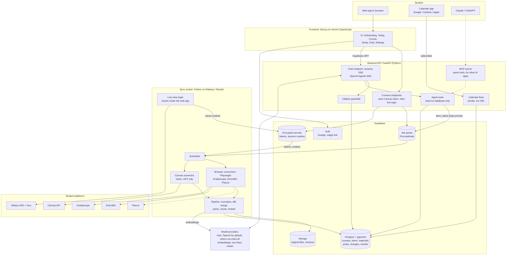
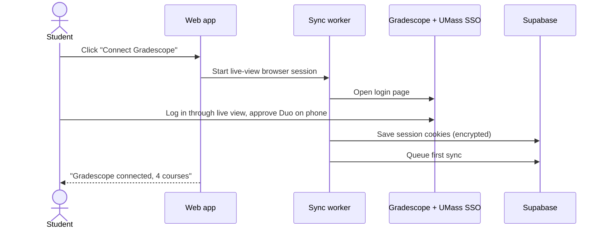
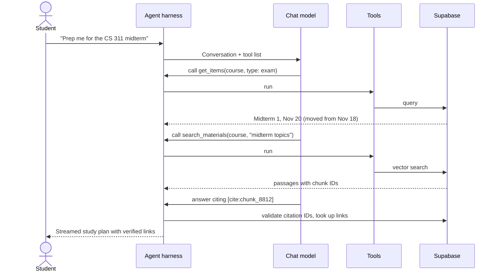

# 03 — Architecture

> Draft to guide implementation. Dashed lines = stretch. Open questions ([06](06-open-questions.md)) may change details, not the overall shape.

## System diagram



**The one rule the diagram encodes:** the AI never touches the platforms. The **sync worker** (plain code, no AI) is the only thing that talks to Canvas/Gradescope/Echo360 and the only thing that reads tokens and cookies. The **agent** only reads our database. A malicious Piazza post can't make the AI submit anything, because no tool can. Sync details: [07](07-sync-and-storage.md).

## Key flows

**Connect a platform** (Gradescope shown; Canvas is just "paste token → validate → save → queue first sync")


**Ask a question**


## Agent and tools

**Harness = the loop around the model.** It sends the model the conversation plus a tool list; the model asks to call a tool; the harness runs it and returns the result; repeat until the model answers (step limit ~8).

**We use the OpenAI Agents SDK (Python)** inside FastAPI:
- **Tools** are plain Python functions with Pydantic-typed arguments, registered via the SDK's function-tool decorator. Keep them framework-agnostic in `backend/agent/tools/` so swapping harness later is hours, not a rewrite.
- **Structured output** (`output_type`) returns study plans, quizzes and flashcards as data the UI renders as cards.
- **Citation check** runs as an **output guardrail**: drop chunk IDs not returned by this run's tools; check quoted text appears in the cited chunk.
- **Writes need a click:** `add_study_block` pauses for approval (SDK human-in-the-loop if available, else our own confirm step in the UI).
- **Streaming:** run in streamed mode; FastAPI forwards events to the browser as Server-Sent Events (text deltas, "tool running" status, final structured result).
- **Models:** OpenAI by default; Claude, Gemini and Ollama via the SDK's LiteLLM model adapter. Test our tools on each model we offer; adapter models are second-class.
- **Tracing is OFF by default for us** (or sent to our own logger). The SDK's default sends traces, including course content, to OpenAI.

**Tools are organized by action, not by platform.** Sync already merged every platform into the same tables, so one `search_materials` covers Canvas files, Echo360 transcripts and Piazza posts; the platform is just a filter.

| Tool | Does |
|---|---|
| `get_items(course?, type?, from?, to?, source?)` | Deadlines, exams, quizzes |
| `get_changes(since?, course?)` | Moved deadlines, edited announcements |
| `search_materials(query, course?, kind?, source?)` | Semantic search over slides, transcripts, posts; returns passages + chunk IDs |
| `get_material(id, pages? or time range?)` | Read a full section (e.g. slides 10–20) after search finds it |
| `get_course_overview(course)` | Syllabus, grading, schedule, staff |
| `get_grades(course?)` | Scores and weights (stretch) |
| `fetch_latest(scope)` | When the DB can't answer or is stale: queue a high-priority sync of one course / item / file / source, wait (≤15 s), re-query. See [07](07-sync-and-storage.md#on-demand-sync-agent-triggered) |
| `create_study_set(type, ...)` | Study plan / quiz / flashcards as structured data for the UI |
| `add_study_block(...)` | Add to the calendar feed; **requires the student's click** |

**Why ~9 tools, not dozens:** more tools makes models *worse* at choosing (overlapping tools get confused, smaller/local models degrade fast) and every tool definition costs tokens on every request. Breadth comes from parameters (filters), not more tools. Add a tool only for a genuinely new *kind of action*. If the list grows past ~15, load tools per mode (study vs. planning) instead of all at once.

**MCP:** our own agent calls tools as plain functions (simpler, faster). As a stretch, we expose the **same tools as one MCP server over our combined data**, so students can use their organized course data inside Claude or ChatGPT. Not one MCP server per platform: that would bring back live pulling and give the AI platform access.

## Tech stack

**Decided: Next.js (TypeScript) frontend + Python backend.** Frontend is UI only; agent, API, sync and file processing are Python.

| Layer | Choice | Why |
|---|---|---|
| Frontend | Next.js + Tailwind + shadcn/ui on Vercel | Fast modern UI |
| App auth | Supabase Auth (Google + magic link); FastAPI verifies the Supabase JWT on every request | One click for students; one identity across both halves |
| Backend API | FastAPI (Python, managed with `uv`) | Async, Pydantic-native, SSE streaming |
| Agent harness | **OpenAI Agents SDK (Python)** | Tool loop, structured output, guardrails, human-in-the-loop, streaming |
| Models | OpenAI default; others via LiteLLM adapter | Model choice in settings |
| Data | Supabase: Postgres + pgvector, Storage, encrypted secrets | One service; see [07](07-sync-and-storage.md) |
| Sync | Python worker + **Procrastinate** (Postgres job queue: priorities, locks, retries); `httpx` for Canvas; Playwright (Python) for the rest | Deterministic, no AI driving browsers |
| Doc parsing | PyMuPDF, python-pptx, markitdown | Python's strongest advantage: better slide/PDF text |
| MCP server (stretch) | Official MCP Python SDK | Same tools exposed to other AI apps |
| Hosting | Vercel (frontend) + Supabase + Railway / Render (two Python processes from one codebase: API and worker) | Minimal devops |

**The contract between the halves:**
- **SQL migrations in `db/` are the single source of truth** for the schema. Generate TypeScript types for the frontend (Supabase CLI) and keep Pydantic models in the backend matching them.
- **Chat stream format** (SSE event types) and **REST endpoints** are documented in `backend/api` and are the only way the frontend talks to the backend (plus Supabase Auth, and direct read-only Supabase queries for the dashboard if convenient, protected by Row Level Security).
- **Sync and API never call each other**: they meet only at the database and the job queue.

### Agent harness options considered

| Option | Verdict |
|---|---|
| **OpenAI Agents SDK** | ✅ **Chosen.** Simplest solid Python option; guardrails and approvals built in. Cons: non-OpenAI models via adapter; tracing must be turned off |
| Vercel AI SDK | Would have been the pick for all-TypeScript; native multi-provider + React streaming |
| LangGraph / Pydantic AI | Viable Python alternatives; more structure (LangGraph) than we need |
| **OpenAI Codex** (open source, Apache-2.0) | ❌ Not as the core: a *coding* agent (shell + file-edit tools, repo sandbox, CLI process per session); shell access + untrusted Piazza/email content = injection risk. ✅ For building the project, and a stretch "self-healing connector" agent that proposes scraper fixes as PRs |
| Claude-only agent SDKs | ❌ Conflicts with model choice |
| LibreChat / Open WebUI | Fallback only: could host our MCP server if custom chat runs late |

## Where each piece lives in the repo

```
apps/web/            Next.js frontend (TypeScript): UI only
backend/             Python (uv project)
  api/               FastAPI: chat (SSE), connect, calendar feed, MCP (stretch)
  agent/             Agents SDK agent, tools/, guardrails, prompts
  connectors/        Canvas, Gradescope, Echo360, Piazza: fetch + normalize
  sync/              worker, scheduler, pipeline, file processing, live-view login
db/                  SQL migrations (source of truth), Row Level Security policies
apps/extension/      Browser extension (stretch)
```

## Security and privacy
- **AI never sees credentials**; tools are read-only except `add_study_block`, which needs a click.
- **Prompt injection:** content from Piazza/email is wrapped and labeled as untrusted data in prompts.
- **One fixed embedding model**, independent of the chat model, so switching models doesn't require re-embedding.
- **Data responsibility:** encryption at rest (incl. tokens and cookies); "Delete my data" removes every row, file and secret; "Disconnect" stops sync and deletes that credential; keep old versions only for the current semester; local/campus-hosted model option for sensitive materials.
- **Copyright:** lecture slides are course property; personal study use only, no sharing features.
