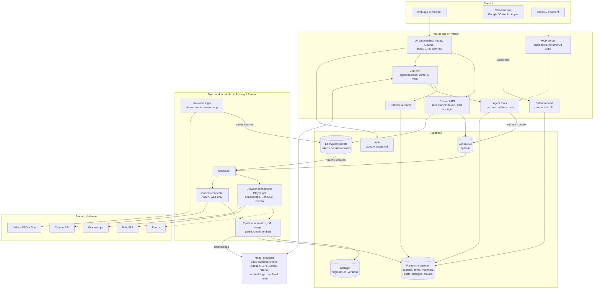
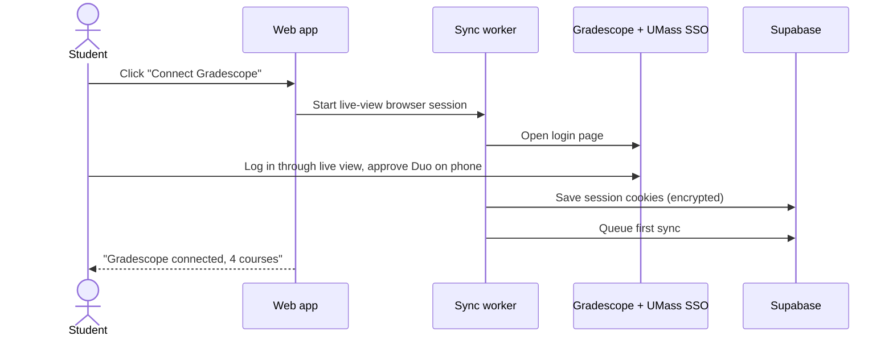
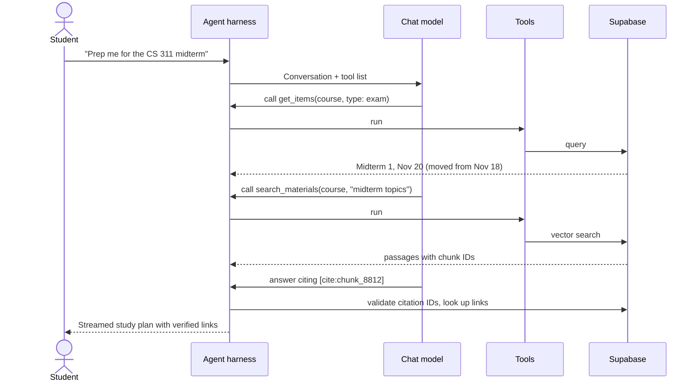

# 03 — Architecture

> Draft to guide implementation. Dashed lines = stretch. Open questions ([06](06-open-questions.md)) may change details, not the overall shape.

## System diagram

**The one rule the diagram encodes:** the AI never touches the platforms. The **sync worker** (plain code, no AI) is the only thing that talks to Canvas/Gradescope/Echo360 and the only thing that reads tokens and cookies. The **agent** only reads our database. A malicious Piazza post can't make the AI submit anything, because no tool can. Sync details: [07](07-sync-and-storage.md).

## Key flows

**Connect a platform** (Gradescope shown; Canvas is just "paste token → validate → save → queue first sync")

**Ask a question**

## Agent and tools

**Harness = the loop around the model.** It sends the model the conversation plus a tool list; the model asks to call a tool; the harness runs it and returns the result; repeat until the model answers (step limit ~8). The **Vercel AI SDK** gives us this loop, one interface for every model provider, streaming to React, and structured output (quizzes/flashcards as data, not prose).

**Tools are organized by action, not by platform.** Sync already merged every platform into the same tables, so one `search_materials` covers Canvas files, Echo360 transcripts and Piazza posts; the platform is just a filter.

| Tool | Does |
|---|---|
| `get_items(course?, type?, from?, to?, source?)` | Deadlines, exams, quizzes |
| `get_changes(since?, course?)` | Moved deadlines, edited announcements |
| `search_materials(query, course?, kind?, source?)` | Semantic search over slides, transcripts, posts; returns passages + chunk IDs |
| `get_material(id, pages? or time range?)` | Read a full section (e.g. slides 10–20) after search finds it |
| `get_course_overview(course)` | Syllabus, grading, schedule, staff |
| `get_grades(course?)` | Scores and weights (stretch) |
| `refresh_course(course)` | Ask the sync worker for an update now |
| `create_study_set(type, ...)` | Study plan / quiz / flashcards as structured data for the UI |
| `add_study_block(...)` | Add to the calendar feed; **requires the student's click** |

**Why ~9 tools, not dozens:** more tools makes models *worse* at choosing (overlapping tools get confused, smaller/local models degrade fast) and every tool definition costs tokens on every request. Breadth comes from parameters (filters), not more tools. Add a tool only for a genuinely new *kind of action*. If the list grows past ~15, load tools per mode (study vs. planning) instead of all at once.

**MCP:** our own agent calls tools as plain functions (simpler, faster). As a stretch, we expose the **same tools as one MCP server over our combined data**, so students can use their organized course data inside Claude or ChatGPT. Not one MCP server per platform: that would bring back live pulling and give the AI platform access.

## Tech stack (proposed, not locked)

| Layer | Choice | Why |
|---|---|---|
| Frontend | Next.js + Tailwind + shadcn/ui | Fast modern UI |
| App auth | Supabase Auth (Google + magic link) | One click for students |
| Agent harness | **Vercel AI SDK** (optionally **Mastra** on top) | Open source, TypeScript, tool loop, streaming, MCP, multi-provider |
| Models | AI SDK providers (or LiteLLM / OpenRouter) | Claude, GPT, Gemini, local Ollama, chosen in settings |
| Data | Supabase: Postgres + pgvector, Storage, encrypted secrets | One service; see [07](07-sync-and-storage.md) |
| Sync | Node worker + pg-boss; Canvas via fetch; others via Playwright | Deterministic, no AI driving browsers |
| Doc parsing | pdf-parse / markitdown / unstructured | Slides → text passages |
| Hosting | Vercel (web) + Supabase + Railway / Render / Fly.io (worker) | Minimal devops |

**Language:** leaning TypeScript everywhere. If one teammate is much stronger in Python, the agent could sit behind FastAPI instead.

### Agent harness options considered

| Option | Verdict |
|---|---|
| **Vercel AI SDK / Mastra** | ✅ Recommended. Built for custom tools + streaming to a web app + many providers |
| LangGraph / Pydantic AI | ✅ Good if we go Python |
| **OpenAI Codex** (CLI + SDK, Apache-2.0, supports custom providers) | ❌ Not as the core. It's a *coding* agent (file edits, shell, repo sandbox). Fine as a dev tool for us |
| Claude-only / OpenAI-only agent SDKs | ❌ Conflicts with model choice |
| LibreChat / Open WebUI | Fallback only: could host our MCP server if custom chat runs late |

## Where each piece lives in the repo

| Component | Folder |
|---|---|
| UI, Connect API, Chat API, calendar feed, MCP endpoint | `apps/web` |
| Agent tools, prompts, citation validator | `packages/agent` |
| Canvas / Gradescope / Echo360 / Piazza fetch + normalize | `packages/connectors` |
| Scheduler, pipeline, live-view login | `services/sync` |
| Schema, migrations, Row Level Security policies | `db/` |
| Browser extension | `apps/extension` (stretch) |

## Security and privacy
- **AI never sees credentials**; tools are read-only except `add_study_block`, which needs a click.
- **Prompt injection:** content from Piazza/email is wrapped and labeled as untrusted data in prompts.
- **One fixed embedding model**, independent of the chat model, so switching models doesn't require re-embedding.
- **Data responsibility:** encryption at rest (incl. tokens and cookies); "Delete my data" removes every row, file and secret; "Disconnect" stops sync and deletes that credential; keep old versions only for the current semester; local/campus-hosted model option for sensitive materials.
- **Copyright:** lecture slides are course property; personal study use only, no sharing features.
