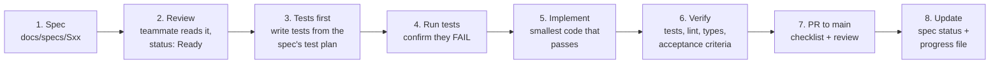

# 08 — Development Workflow

How we build: **stage by stage, spec first, tests first.** Every feature goes through the same lifecycle so three people and three coding agents can work in parallel without breaking each other.

## The lifecycle of one feature



1. **Spec.** Every feature has a spec in [`docs/specs/`](specs/README.md) before any code. It defines purpose, inputs, outputs, interfaces, data flow, rules, errors, acceptance criteria and a **numbered test plan**. Use [`_TEMPLATE.md`](specs/_TEMPLATE.md).
2. **Review.** Another teammate reads the spec (10 minutes). Questions get answered *in the spec*. Status moves `Draft → Ready`. Agents only implement `Ready` specs.
3. **Tests first.** Write the tests listed in the spec's test plan (IDs like `S11-T04`, put the ID in the test name). Tests encode the spec; if a test is hard to write, the spec is unclear: fix the spec.
4. **Confirm they fail.** Run them. A test that passes before the code exists is testing nothing.
5. **Implement** the smallest code that makes the tests pass. No features beyond the spec.
6. **Verify.** All tests pass, lint and type checks are clean, every acceptance criterion is checked off.
7. **PR to `main`** using the PR template. Small PRs. Another teammate (or their agent) reviews.
8. **Update** the spec status (`Done`) and your file in [`docs/progress/`](progress/README.md).

**If implementation reveals the spec is wrong:** stop, update the spec (and tests) first, note it in your progress file, then continue. Never let code and spec drift apart.

## Stages

Features are grouped into stages. **Don't start a stage's features until the previous stage's contracts are merged.** Within a stage, the three roles work in parallel. The full feature list with owners is in [specs/README.md](specs/README.md).

| Stage | Hours | Goal | Exit criteria |
|---|---|---|---|
| **0. Foundations** | 0–2 (together) | Repo, tooling, and the three contracts | S00–S03 merged: scaffolds run, schema migrates, API/SSE contract written, seed data loads |
| **1. Vertical slice** | 2–10 | One real question answered end to end | Checkpoint H10: Canvas data synced → agent answers with citations → UI shows it |
| **2. Depth** | 10–18 | Browser connectors, study mode, approvals | Checkpoint H18: study mode with verified citations from real data; Gradescope connected |
| **3. Completeness** | 18–24 | Merge/changes, models, onboarding, settings | Checkpoint H24: MVP feature freeze; full demo run-through passes |
| **4. Hardening + stretch** | 24–36 | Bugs, demo, stretch goals | H30 code freeze; demo rehearsed |

## Testing strategy

| Layer | What | Tools | Where it runs |
|---|---|---|---|
| **Unit** | Pure logic: diffing, merge rules, chunking, citation validation, ICS generation, mappers | `pytest`; `vitest` | Every PR (CI) |
| **Connector** | Parse saved platform responses into normalized records | `pytest` + `respx` (mock `httpx`) + saved HTML/JSON fixtures in `backend/tests/fixtures/` | Every PR |
| **Integration** | Repositories, RLS, pipeline writes, API endpoints against a real local DB | `pytest` + local Supabase (`supabase start`) | Every PR |
| **Agent runtime** | Harness behavior (tool dispatch, SSE mapping, citation post-processing) with a **scripted fake model** that returns predetermined tool calls | `pytest` + `ScriptedModel` (see [S22](specs/S22-agent-runtime-and-chat.md)) | Every PR |
| **Frontend component** | Components and hooks against mocked API | `vitest` + React Testing Library + MSW | Every PR |
| **End to end** | Key user flows in a browser | Playwright (against MSW mocks on PRs; against the real stack at checkpoints) | PR (mocked), checkpoints (real) |
| **Model evals** | Real models answer golden questions correctly | `backend/evals/` ([S26](specs/S26-model-picker-and-evals.md)) | Manually before checkpoints; never in CI (costs money, non-deterministic) |

**Rules**
- **No live platform calls in tests.** Fixtures only. Capture fixtures from our own accounts and **scrub personal data** (names, emails, IDs → fake values) before committing.
- **No real LLM or embedding calls in tests.** Use `ScriptedModel` and `EMBEDDINGS_PROVIDER=fake` (deterministic hash-based vectors).
- **Deterministic time.** Inject a clock (`now()` dependency); never call `datetime.now()` directly in logic.
- **Each spec's test IDs appear in test names**, so `pytest -k S11` runs one feature's tests.
- **Coverage target:** high on pure logic modules (diff, merge, citations, chunking, ICS); don't chase a global number.

## Definition of Done (every feature)
- [ ] Spec status was `Ready` before implementation started
- [ ] All tests in the spec's test plan exist (IDs in names) and pass
- [ ] Lint + format + type checks clean (`ruff`, `pyright` or `mypy`; `eslint`, `tsc`)
- [ ] All acceptance criteria checked off in the spec
- [ ] No contract changed without team agreement ([AGENTS.md](../AGENTS.md#contracts-change-only-with-whole-team-agreement))
- [ ] No secrets, no personal data in fixtures
- [ ] Spec status set to `Done`; progress file updated
- [ ] PR merged to `main`

## Handing a spec to your coding agent

Copy this prompt, fill in the spec ID:

```text
Read AGENTS.md, docs/08-development-workflow.md, and docs/specs/<SPEC-ID>-*.md.
Implement <SPEC-ID> following the workflow:
1. Write the tests listed in the spec's "Test plan" first (put the test ID in each test name).
2. Run them and show me that they fail.
3. Implement the smallest code that makes them pass. Stay inside the spec's scope and my role's folders.
4. Run all tests, lint and type checks. Check off the acceptance criteria.
5. If the spec is unclear or wrong, stop and ask me before changing behavior or any contract.
6. Update docs/progress/<my-name>.md. Do not commit or push unless I ask.
```

## Writing a good spec
- **Concrete over vague:** exact function signatures, endpoint paths, JSON shapes, table columns, error codes.
- **Examples:** at least one realistic input and output.
- **Edge cases and errors** are part of the spec, not afterthoughts.
- **Test plan:** numbered, one line each, covering happy path, edge cases and errors. Aim for 5–15 tests.
- **Out of scope:** say what this feature does *not* do, so agents don't over-build.
- **Link, don't repeat:** reference other specs and docs instead of copying them.
