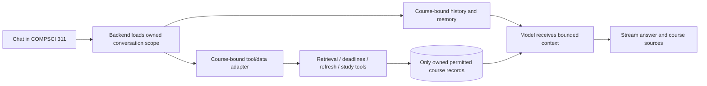

# Course workspaces, chat context and student-first UX

**Draft design amendment — 2026-11-23.** User-requested addition to the post-hackathon plan. No application code, migrations, dependencies or skills installed. Existing S35 supplies the maroon UI foundation; S36 supplies conversations with saved study sets. This design extends them rather than rebuilding chat.

## Product goal

A busy first-year UMass student should open the app, find the right class, ask a useful question and resume their work without learning AI terminology or building a project hierarchy. Present familiar words: **Today, General Chat, Courses, Chats, Projects, Saved study tools**. Projects are optional organization for coursework, not a prerequisite for asking anything.

A course workspace groups context, chats, optional projects and saved output. It is private to the student. Two students in the same course never share chats or memory automatically. General Chat handles questions across the student's selected courses, planning their week and anything that does not fit one class. Source permissions and per-user isolation still apply everywhere.

## Information architecture

```text
Today
General Chat
  Recent general chats
Courses
  COMPSCI 311 · Algorithms · Fall 2026
    Overview
    Chats
      Explain dynamic programming
      Homework 5 practice
    Projects (optional)
      Midterm 1 prep
        Chats
        Saved flashcards / quizzes / plan
    Materials
    Saved study tools
  MATH 235 · Linear Algebra · Fall 2026
    ...
Settings
```

A **course** is the selected canonical course/term, including its approved cross-platform links. A **project** is an optional named group inside one course, such as “Midterm 1 prep” or “Final paper.” A **chat** is one conversation inside General Chat, a course or a course project. Saved quizzes/flashcards/plans remain linked to the originating conversation and course/project where applicable. Initial depth is course → optional project → chat; no recursive folders or required project setup.

Desktop navigation shows Today, General Chat and the selected current courses; old terms collapse separately. A course opens an overview with upcoming work, recent chats and one prominent **Ask about this class** action. Secondary sections can be tabs/links, not five competing primary buttons. On phones use Today / Courses / Chat / Settings; Chat resumes the last active context with an always-visible course/general label and a clear chooser. Preserve drafts and scroll per chat, but reset them on identity change.

## Core student flows

| Situation | Intended flow |
|---|---|
| First useful question | Today → course → Ask about this class → type; no project or prompt configuration required |
| General planning | General Chat → “What should I focus on this week?”; show “All selected courses” scope |
| Course help | COMPSCI 311 → chat → “Explain this week's lecture”; course filter is already set |
| Exam project | Course → New project → “Midterm 1 prep” → new chat; generated quiz/flashcards appear inside that project |
| Return tomorrow | Course → recent chat or project → continue; original conversation and saved tools persist |
| Ask about a different class | Visible scope chooser offers a new chat in that class, preserving the current chat/draft; no silent rebinding |
| Cross-course comparison | Start General Chat (or an explicitly designed multi-course scope later), rather than silently widening a single-course chat |
| Missing source | Plain explanation plus one action: connect, refresh or choose another question; never invent missing course facts |

Suggested questions depend on the selected context and available sources: “What's due next?”, “Explain this topic”, “Make a practice quiz”, “Help me plan study time.” Do not display unavailable actions as if they work. Answers lead with useful content and expandable sources, then an appropriate next action; internal tool names, embeddings, context windows and provider settings stay out of the main student flow.

## Context is an enforced boundary, not a prompt hint

Current evidence: `api/schemas.py` ChatRequest accepts a conversation/message, conversation tables have no course/project binding, and `agent/tools/context.py` has no server-enforced active course scope. Tools accept course filters, but the current filter mechanism is not a persisted course-workspace security boundary. Existing Sessions is therefore a useful base, not this feature already implemented.

For a new conversation, the backend validates the authenticated owner and canonical course/project association, persists the scope and returns it in the conversation view. For an existing conversation it loads that persisted scope, not a course name supplied by the model or a URL. A project belongs to one owned course; a conversation's project and course must agree. General is an explicit scope value, never an accidental null that widens a malformed request.



Every read tool must inherit the scope: course list/overview, deadlines/items, changes, materials/search/chunks, citations, source coverage and refresh requests. Omitting a model course argument in a course chat means that course, not all courses. Conflicting course IDs, foreign chunk/item/project IDs and out-of-scope citations are rejected. Validate again when resolving files/citations and writing study artifacts. Tools cannot expand permissions by following instructions in a PDF, post or email. Tool descriptions can be narrower for clarity, but backend checks are authoritative.

A course chat may propose its own course's study sessions. If availability permission exists, a narrowly defined scheduling tool can return free/busy intervals across the user's calendar without importing unrelated event descriptions into course chat. The student approves the exact proposed event/time/calendar before any external write. Unsupported operations produce a clear alternative, not silent broad tool access.

Canonical course merges must preserve or explicitly redirect existing chat/project bindings through validated owned aliases; course names alone cannot reassign context. Scope is stable for a running turn, and stale responses must settle into their originating chat rather than the newly opened one.

Changing context creates a new scoped conversation initially. Do not relabel a mixed General conversation as course-only or feed its other-course history into a new course chat. Organization moves inside the same course may be supported with validation; cross-course moves are deferred until their history/memory/citation semantics have a separate design.

## Memory without surprise

| Layer | Contents and scope | Student control |
|---|---|---|
| Account preferences | Timezone, accessibility and response-format preferences; no implicit shared academic facts | View/change/reset in Settings |
| Course evidence | Current selected-course records and cited source passages; belongs to course/term | Source/course selection and refresh/delete controls |
| Course memory | Explicitly saved learning preferences/goals for this course, such as “give me a worked example first” | Preview/approve, view/edit/delete; never silently copied to another course |
| Project context | Chosen objective, source references, approved notes and saved tools for that coursework | Visible project context; sources remain course-scoped and permission-checked |
| Chat history | This conversation's turns and a bounded derived summary if needed | Existing chat controls; explain summary behavior and deletion |

Project notes, remembered text and summaries are context data, never authority to expand tool permissions.

Default behavior retrieves current evidence and this chat's history; it does not concatenate every old chat in the class. Cross-chat durable learning memory is optional and student-approved. Automatically generated summaries remain local to the conversation unless the student explicitly saves something more broadly. Summaries preserve source references/version and timestamps where factual; an old “exam is Tuesday” note cannot outrank a current authoritative deadline. General Chat can retrieve the student's selected course data for a cross-course request but does not automatically reuse private project/course-memory notes.

Bound context by tokens/relevance, not only message count. Cache keys include user, conversation, course/project scope, memory version and source/index generation. Archived terms, removed courses and deleted sources must not silently remain active retrieval/memory inputs. Deleting or changing source permission invalidates derived memory/retrieval caches; retained historical citations follow the explicit history policy. Student-facing memory controls explain what deleting a chat removes and which saved study tools remain, consistent with current S36 behavior.

## UI direction and interaction requirements

Retain the existing Next.js/Tailwind/shadcn foundation, Fraunces/Geist hierarchy where useful, and source/citation/approval/SSE contracts. Use maroon as a deliberate identity/active-action accent, calm neutral reading surfaces, generous spacing and clear hierarchy. The official UMass Amherst palette currently lists maroon **#840028** and black **#212721**; check contrast for every actual text/background/state rather than assuming brand colors are accessible everywhere. Keep the student-project/non-official identity. [UMass brand colors](https://www.umass.edu/brand/visual-identity/brand-colors).

- Today stays the first useful screen. Show due-now work, selected courses and one obvious next action; reduce old-term clutter and administrative panels.
- Course name and term stay visible in chat and above the composer. Show “General · All selected courses” in General Chat; never rely on color alone to communicate scope.
- Keep a readable answer width, source evidence one action away, copy/retry/stop where appropriate and saved study tools easy to reopen. Avoid competing sidebars and repeated chat lists.
- Preserve existing navigation/state through normal route changes; use scoped caches, prefetching and loading skeletons instead of page-wide blank flashes. Validate actual route/data latency; do not promise instant network work.
- SSE renders progressively, groups tool progress into useful plain-language status, supports Stop/retry and preserves partial answers honestly. Do not remount the entire transcript for each text delta. Respect scrolling up and offer Jump to latest; avoid noisy screen-reader announcements per token.
- Phone keyboard, safe areas, sticky composer, source drawer and navigation must work together. Validate 320/375/768/1280px, portrait/landscape, zoom and long course/chat titles, not just a desktop screenshot.
- Keyboard/focus/contrast/reduced motion, meaningful button labels and roughly 44px touch targets are acceptance criteria. Use [WCAG 2.2 AA](https://www.w3.org/TR/WCAG22/) as the proposed accessibility target; an automated score alone does not establish conformance.
- Empty states give examples and a primary action; loading states show progress without fake completion; error states explain one recovery action. No disabled-control maze, mandatory tutorial or model/provider picker in the main flow.

## Design skills and primary references researched

Research checked 2026-11-23. These are candidates for the future approved UI work, not newly installed dependencies. Read/pin their source and license before use, and record outside code/notices if anything is copied. Do not allow a generic design skill to override student accessibility, privacy or existing repo constraints.

| Resource | Use in implementation workflow | Status |
|---|---|---|
| [Anthropic frontend-design](https://github.com/anthropics/skills/blob/main/skills/frontend-design/SKILL.md) | Deliberate subject-specific visual direction and typography; apply to a UMass study workspace, not a flashy unrelated landing page | Primary skill source inspected; candidate, not installed/applied |
| [Vercel web-design-guidelines](https://github.com/vercel-labs/agent-skills/blob/main/skills/web-design-guidelines/SKILL.md) | Design/accessibility review using its bundled pinned interface guidelines | Primary skill source inspected; candidate, not installed |
| [Vercel React best practices](https://github.com/vercel-labs/agent-skills/blob/main/skills/react-best-practices/SKILL.md) | Avoid request waterfalls, excessive rerenders and unnecessary bundles; check applicability to installed Next16 | Primary skill source inspected; candidate, not installed |
| [OpenAI curated skills](https://github.com/openai/skills/tree/main/skills/.curated) | Current catalog includes Figma design/implementation/design-system and Playwright/interactive/screenshot verification options | Catalog checked with skill-installer; none installed; use Figma only if a design file/workflow is adopted |
| [assistant-ui ThreadList](https://www.assistant-ui.com/docs/primitives/thread-list) and [Composer](https://www.assistant-ui.com/docs/primitives/composer) | Reference for thread switching, chat controls and accessible composition | Patterns only; no library migration proposed |
| [Vercel AI SDK chat example](https://vercel.com/academy/ai-sdk/basic-chatbot) | Reference for progressive chat UX | Patterns only; retain working FastAPI/Agents SDK/SSE backend |

A useful future sequence is visual-direction skill → existing-component implementation → interface-guideline review → React/Next performance review → interactive browser/accessibility/usability verification. Evaluate the result against student tasks; attractive styling alone does not pass.

## Measurable student-first review

Before implementation, prototype the first-use, course-chat and return-to-project flows. Test with at least five representative non-technical students who did not build the app. Proposed gate: at least four of five complete each task without coaching; capture failures and revise before broader pilot. Targets are proposals, not measured results:

1. Find the next deadline and open its source within 30 seconds after Today loads.
2. Start a course-specific question and correctly name its active course within 60 seconds.
3. Find yesterday's chat/quiz and continue within 30 seconds.
4. Understand General versus course chat and switch through a new chat without losing current work.
5. Create an optional exam-prep project, find its saved tools and understand Add/Skip study approval.
6. On a phone, type, stop a streamed answer, inspect a citation and return without losing the draft or scope.

Track success, time, misclicks, scope confusion, perceived responsiveness and help requests. Do not substitute team-member familiarity or a polished screenshot for usability evidence. More exhaustive memory/privacy tests are in P15; UI/stream/performance/usability tests in P16.
