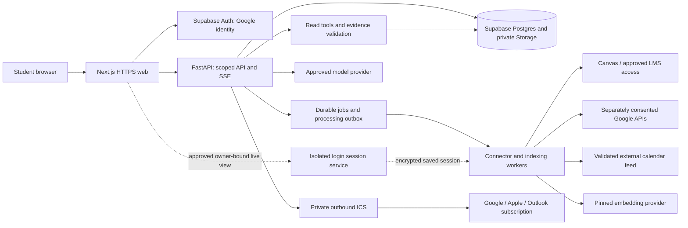

# Post-hackathon product and deployment design

**Draft for review — 2026-11-23. No implementation approved by this document.** Baseline: `origin/main` at `be13793`. Work branch: `post-hackathon-plan/changes`. The user reports judging is complete and asks for a deployable student/professor product. Historical hackathon deadlines, demo shortcuts and old progress tables are not the current release plan.

## Proposed first release

Build an invite-only student-private pilot, retaining Next.js, FastAPI, Supabase, Procrastinate and the existing streaming chat. Start with a dependable Canvas + Today + cited study help + private calendar experience. Preserve Gradescope and Piazza support, but gate their hosted availability on a real remote-login decision and test; a local demo login window cannot be offered to a remote student. Start Google approval work early, and release Gmail and richer Calendar features through separate gates. This is a proposed sequence, not a decision to drop requested features.

Assume 25 invited students for capacity planning until the team chooses a scale. The optional budget question is pending; cost scenarios are in [models and costs](models-and-costs.md). No purchases or deployments are included in this planning phase.

Professors can initially use the same private workspace for their own authorized sources. Shared classes, student rosters/grades, teaching analytics and organization administration need a separate authorization/data-governance design. Never infer instructor powers from an email domain or automatically share course data across students. Treat student status, identity and teaching role as separate facts.

## Evidence baseline

| Capability | Actual state on main | Next design requirement |
|---|---|---|
| Google app login | Supabase OAuth/PKCE code and feature flag exist; hosted configuration not verified | Production OAuth client, callbacks, trusted eligibility and account-linking policy |
| Canvas | Guided personal access setup, GET-only connector, real dashboard and cited answers | Production secret handling, selection, recovery and least-privilege policy; official OAuth/LTI exploration later |
| Gradescope/Piazza | Built, historical local live checks recorded | Hosted normal-login/MFA architecture; no passwords in app forms |
| Platform/class choice | Canvas-first wizard; Settings can add other supported accounts later | Server-persisted optional platform selection, discovery then course inclusion |
| Calendar | Private outbound ICS + approved study sessions | HTTPS subscriptions first; Google OAuth, inbound feeds and snapshots are separate features |
| Gmail | Not implemented | Independent Google consent, restricted-scope review, bounded mailbox ingestion |
| RAG/sync | Hybrid search, citations, encrypted secrets and tested pipeline exist | Fix audited correctness/recovery gaps before benchmarking optimizations |
| Operations | Local demo scripts; CI runs offline backend/frontend checks | Reproducible hosted artifacts, production safety checks, DB CI, restore/limits/monitoring |

Evidence details and code references: [deployment/auth audit](audit-deployment-auth.md), [connector/onboarding audit](audit-connectors-onboarding.md), [RAG/sync audit](audit-rag-sync.md). These are source audits, not production penetration tests or measured performance results.

## Student journey

1. **Continue with Google.** Request identity only. Google and the university handle their own sign-in redirects and Duo if required. Do not invent a SPIRE login hop. UMass Google identity does not grant LMS/mail/calendar access. Use an invitation gate initially; validate trusted identity on the server. The exact institution-managed account flow needs a staging check. Current official sources support student Gmail, while faculty/staff coverage varies; see the identity audit.
2. **Choose your sources.** Accessible checkboxes for Canvas, Gradescope, Piazza, Gmail and calendar capabilities; availability labels come from the server. Unsupported platforms show an explanation rather than a broken Connect button. “Set up later” works with no selected platforms. Store progress on the server so a phone or another browser can resume.
3. **Connect one source at a time.** Explain the information imported, storage, AI processing and how to disconnect/delete it. Canvas shows its existing guided access-code steps. Gradescope/Piazza use an approved provider/hosted-session flow where available. Gmail/Calendar open their own Google consent only when chosen. Never collect platform passwords in our app or chat.
4. **Discover then choose classes.** Fetch bounded class metadata first, show current semester and other terms, then let the user choose courses before fetching files/posts. Match equivalent source courses carefully with visible corrections. Selecting a platform is not permission to import every historical course. Class selection limits app behavior; broad platform tokens may still have broader technical access, which must be explained honestly.
5. **Enter Today.** Each selected source shows connection/import/organization/search readiness separately. A failed optional connector does not block the whole workspace. A read-only dashboard remains useful during model outages or exhausted AI budgets. Deadlines come from deterministic source records; uncertain email-derived dates appear as suggestions requiring confirmation.
6. **Manage later.** Settings supports adding sources/classes, reconnect, scope changes and calendar direction. Distinguish disconnect (stop updates and forget grant), remove retained source data, clear workspace, and delete account. Explain what already-exported calendar events or backup retention cannot retract immediately.

## Course workspaces and student-first interaction

The user explicitly requested General Chat plus course-specific chats/projects and a responsive modern maroon interface. [Course chats and UX](course-chats-and-ux.md) owns the detailed design. Retain Today first; add a direct “Ask about this class” path without requiring project setup. Each course can group chats and optional coursework projects with saved study tools. General Chat handles cross-course requests. Keep the active course/term or General scope visible at the composer.

Course context is loaded from an owned persisted conversation and enforced across every relevant tool/query/citation/artifact, not merely written in the prompt. Course chats do not inherit unrelated chat history or hidden cross-course memory. Student-approved course/project memory is inspectable and removable; bounded conversation summaries do not become invisible global memory. Fresh source facts take precedence over remembered notes. Existing chats migrate to explicit General scope; they are not silently assigned to guessed courses. New contracts require review before code.

Use the existing S35 Tailwind/shadcn/UMass-maroon foundation and S36 conversation/study-set behavior. Prioritize novice student task success, accessible controls, phone keyboard/composer fit, useful empty states, source visibility, smooth SSE and retained navigation state. Visual-direction, interface-review, React-performance and browser-testing skill candidates are recorded in the detailed brief; none installed. P15 (context/workspaces/memory) and P16 (student UX) are part of the proposed pilot gates, with a prototype/usability loop before implementation.

## Architecture and trust boundaries

Keep API, sync/index workers and any remote-login browsers as separate services/resource pools. Long-lived API hosting must support SSE through its real proxy, with no buffering, bounded timeouts, cancellation and graceful deploy draining. Persistent work/checkpoints belong in Postgres, not API memory. Keep metadata/merge work responsive while bulk files index. Use same-region managed data/compute where practical; choose concrete hosting after measuring process memory, pool counts and budget. Vercel for web plus a managed container host for API/workers is one option, not a mandated purchase.

Use separate development/staging/production Supabase projects, OAuth clients/redirects and credentials. Production must reject mock data, scripted chat fallback, fake embeddings, localhost public URLs and local browser fallback. Never run seed/reset commands in production. Review runtime/migration database roles, private bucket policies, signed/authorized file access, dependency licenses, especially the existing AGPL dependency, and operator access. DB backups alone do not recover object files or encryption keys.

### Identity and Google access

Separate **app session** from **provider grants**. An authenticated app user may connect a different Google account deliberately; show that account and bind consent transactions to the intended app user. Do not merge accounts by matching untrusted email text. Server eligibility uses trusted claims/invitations, with verified project issuer/audience/expiry; Google `hd` chooser hints alone are insufficient. Exact Supabase identity metadata/hook behavior requires a spike before choosing the eligibility mechanism.

Provider grants need encrypted refresh credentials, scope/version metadata, refresh locking, revocation and least-privilege worker access. Request scopes incrementally. An email-only sign-in permission cannot be treated as Gmail/Calendar consent. Google and institutional admin review can block grants even if a personal account works. Begin domain ownership, privacy/support pages and consent verification while engineering proceeds; these are external dependencies, not code-only tasks.

### LMS access

Canvas PAT remains the established initial path with expiration/reconnect guidance and GET-only network enforcement. An official developer key/OAuth or LTI arrangement is a future university/vendor decision; LTI launch does not automatically imply all desired APIs.

For Gradescope/Piazza, compare official access against isolated remotely streamed browser sessions. The remote session must have short-lived owner-bound access, explicit consent, normal MFA, no recordings/password logging, cleanup and durable orchestration across API restarts. Confirm cloud-browser compatibility and platform/institution rules before committing. A local helper/extension changes the current nothing-to-install product requirement and needs a product decision. Until a hosted option passes, keep these connectors available locally and explicitly unavailable in hosted onboarding.

### Calendar directions

| User need | Design |
|---|---|
| See app deadlines in Apple/Google | Existing private HTTPS ICS subscription; provider pulls updates on its schedule. Start here. |
| Import an ICS file | Bounded uploaded snapshot with deduplication/replace/remove; label it as non-updating. |
| Keep app aware of a calendar maintained elsewhere | New subscribed URL connector; ETag/Last-Modified polling, bounded recurrence/cancellation/timezone handling and strict SSRF/egress controls. Published Apple links are sensitive bearer URLs. |
| Find free time in Google | Separate narrow availability consent; prefer FreeBusy if event text is unnecessary. |
| Add approved study sessions to Google | Optional separate consent; prefer a dedicated app-created calendar. Preview and click approval, durable outbox/idempotent writes. Never send invitations or modify unrelated personal events. |

Avoid duplicate deadlines when a user enables both ICS and OAuth exports. Initial direct writes are limited to explicitly approved study sessions; automatic deadline mirroring is a separate policy to review. Never ingest our own exported feed as a new authoritative source. Stable UID/recurrence keys and origin metadata prevent loops. Calendar subscriptions are eventually updated, not real-time push guarantees.

### Gmail

Begin with a selected class-mail label/recent window and a preview of categories, not a complete mailbox history. No send/modify/delete permission, attachments or remote image loads initially. Label selection restricts import policy; it does not shrink a broad OAuth grant. Mail remains owner-private, untrusted source text with stable provenance and retention controls. It must not overwrite an authoritative LMS due date without student confirmation.

Gmail read scopes require Google's restricted-scope process and, for server-held/transmitted data, the applicable assessment. Keep this feature gated until that process and model-data-use review are satisfied. Notifications enqueue cursor reconciliation; store successful cursors, renew watches, handle duplicates/gaps and bounded bootstrap after cursor expiry. See the connector audit for official sources and tests.

## Data and processing invariants

Every new table/query/job/cache includes authenticated ownership. Additive **proposals**, not approved migrations: integration/course preferences and capability state; OAuth grant/scopes/revocation records; per-source/class cursors and watch leases; source/index generations and processing outbox; embedding identity; usage reservations/ledger; deletion lifecycle/fencing. New Gmail/calendar kinds require reviewed DB/API contract extensions. Existing schema/API/SSE/seed contracts remain unchanged during planning.

Presence is separate from content hash: complete authoritative listing may infer absence; caps, hidden tabs and failed pages may not. Reappearing identical content restores presence. Serialize overlapping user/platform imports or publish via generation-safe ownership; emit durable indexing intent with each committed source version. Reconcile pending/failed/stuck work after crashes; transient platform errors recover independently of expired authorization.

New retrieval only uses eligible, present sources and the intended embedding generation. Historical citation resolution remains possible with honest changed/removed labels. Use one pinned embedding model/task/dimension/normalization/extraction version; backfill and atomically cut over if changing it. Never mix fake and real vectors. Treat every imported title, PDF, page, email and post as untrusted. Citation membership and quote similarity do not prove semantic claim support; test that separately and avoid overstating “verified answers.”

Account deletion fences new/running work before cleaning grants, feeds, DB and Storage; idempotent retries complete partial deletion. Switching browser identity cancels inflight responses and resets/scopes every cache/chat state. Privacy views explain retention and exported copies. No shared private embedding/answer cache between students in the first pilot.

## Reliability, affordability and release gates

Measure before replacing working RAG/queue components. Existing vector/full-text indexes and hybrid retrieval are present. First fix removals, publication/retry gaps, stale search and embedding identity; then benchmark SQL bounds, pooled clients, batching, per-user query caching, fair worker capacity and overlap reduction. Detailed findings are in the RAG/sync audit.

Choose one default chat model using the cost/quality procedure in [models and costs](models-and-costs.md). Persist exact model/provider/price versions and all billed usage. Use shared per-user/global admission budgets, bounded input/output/turns/retries/concurrency and circuit breakers. Show a clear retry/budget state; do not silently change who receives student data. Keep raw course/mail text and secrets out of logs/traces/analytics.

Proposed pilot gates: two-user isolation across all surfaces; complete and recoverable deletion; crash-safe imports/indexing; production configuration and issuer enforcement; reachable HTTPS/callbacks/feed; source-provenance and model-quality tests; enforced General/course/project context and novice-student usability; staged SSE/load tests; per-user cost caps; restore drill; named incident/support owners. No audit document asserts these gates already pass. Target service levels must be approved and measured, not promised from the old demo test counts.

## Decisions still required

1. Cohort, budget cap, responsible billing/support owners, region and domain; user budget response if supplied supersedes the working assumptions.
2. Minimum hosted platform set: is Canvas-first acceptable, or must remote Gradescope/Piazza be a launch blocker?
3. Invited personal Google accounts versus verified UMass-only access; professors private-only versus a later institutional product.
4. Desired calendar directions, especially an external updating ICS URL versus merely subscribing Apple to our feed.
5. Provider/privacy terms, retention/deletion policy, Google Gmail assessment funding and UMass IT/vendor contacts.

Review these choices before marking future specs Ready. The [implementation plan](implementation-plan.md) supplies small work packages, tests and dependency gates; none authorizes code yet.
