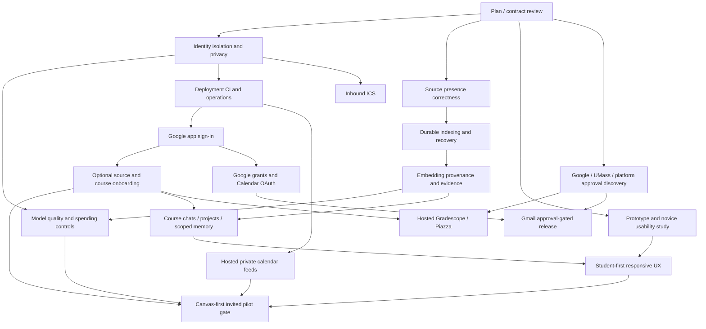

# Implementation plan after design approval

> **Current authorization (2026-11-24):** user approved sequential implementation on `codex/post-hackathon-implementation`, one S37+ spec/test/design/code/check/commit cycle at a time. Keep Gemini and never merge main until explicitly told done. The original planning-only language below records the review baseline; [overnight checkpoint](../handoff/overnight-2026-11-24.md) records actual completed work.

**Draft, planning only — 2026-11-23.** Read [design-plan.md](design-plan.md) first. No work package below is Ready and no application code is authorized in this phase. P00–P16 IDs are planning work packages, not replacements for existing S specs. Before implementation, map each package to a reviewed S37+ spec or a narrow amendment to an existing spec, using the next available IDs at that time.

## Required workflow for every feature

1. Review the feature's design, boundaries, user behavior, failure states and data policies.
2. Review its implementation plan: affected files/services, migration/API/SSE proposals, dependencies, rollback and numbered test plan. Obtain team agreement for schema/API/seed contracts. Mark its spec Ready only after review.
3. Write the numbered tests and observe the meaningful failure against the current behavior. Tests use fixtures, synthetic users, scripted models and fake embeddings. Paid/live checks require a separate controlled, consented verification step.
4. Implement the smallest agreed change, run focused checks, then relevant full suites, lint/types/build and staging checks. Preserve the backup demo separately from production mode.
5. One feature per commit/PR; split large packages into the subfeatures below. Update owning spec, devlog, own progress file and release checklist. Push checkpoints early. Do not merge this planning branch or start code until the user reviews the plan.

Contract changes must expand compatibly, backfill safely, switch readers/writers, then remove legacy behavior only in a later reviewed change. Never reset production. Preserve the current SSE event contract unless a small separately reviewed proposal updates backend/types/UI/tests together.

## Dependency and delivery sequence

Documentation and external access discovery can run alongside engineering. Gmail approval work begins early even though mailbox release is later. If all LMS platforms are required on day one, P10 becomes a pilot gate; this is a product decision rather than a hidden scope reduction.

## Work packages and failing-first acceptance tests

### P00 — Baseline and approval checkpoint

Design: agree pilot cohort, budget, minimum connectors, identity eligibility, professor scope and calendar directions. Implementation preparation: reconcile current code/specs and stale handoff tables; inventory source data, grants and retention; prepare exact contract proposals without migrating anything. Proposed owner: whole team.

Tests/evidence: P00-T01 immutable baseline SHA and clean-code diff; P00-T02 reproducible offline test/lint/type baseline plus explicit unrun DB/staging checks; P00-T03 every launch gate has an accountable owner and acceptance evidence. Review the residual unmerged `origin/dev/soumith` commit before any merge; do not assume branch ancestry alone proves missing runtime behavior.

### P01 — Production identity, browser isolation and deletion

Design: deny unsafe production fallbacks; isolate identity transitions; define clear data/account deletion. Split into P01a startup/JWT validation, P01b browser cache/chat state, P01c durable deletion/fencing. Areas: `core/settings.py`, `core/auth.py`, web auth/providers/query keys, account routes, Storage and queue repositories. Use least-privilege runtime access and managed/versioned encryption secrets.

Tests: P01-T01 wrong issuer/audience/expired key and mock/scripted/fake/local production configuration rejected; P01-T02 A signs out while a delayed request completes, B sees no A cache/chat/preview; P01-T03 deletion with queued and running jobs plus Storage failure retries cannot recreate rows/files, old feed/grants fail; P01-T04 another user, file ID or deletion ID is denied. Rollback must not undo a completed deletion or restore revoked access. Depends P00. **Pilot gate.**

### P02 — Sync presence and concurrency correctness

Design: source presence, complete listing and content changes are separate states. Plan changes in Canvas cap/hidden-module handling, pipeline unchanged branches and execution locking/generations; preserve read-only transport and existing merge protections. Review resource completeness and per-user/platform ownership before code.

Tests: P02-T01 capped 99/100/101 file listings and failed/hidden pages never infer false removals; P02-T02 identical removed content reappears and becomes current; P02-T03 overlapping full/course imports cannot overwrite a newer generation or remove live records; P02-T04 user disconnect/deletion wins over a running import. Depends P00/P01 fencing design. Audit RS02/03/06. **Pilot gate.**

### P03 — Durable processing and source recovery

Design: persist indexing intent with committed source versions and reconcile pending/failed/stuck work. Separate auth expiry from transient transport/embedding/Storage errors. Bound retries/backoff/jitter and worker fairness; refresh readiness reports imported/organized/searchable independently. Areas: sync pipeline/jobs, processing worker/process, migrations for outbox/generation if approved.

Tests: P03-T01 crash after commit before enqueue and later-platform failure still index earlier committed data; P03-T02 provider 429/5xx and Storage failure retry without duplicate current chunks; P03-T03 failed transient connection recovers after outage, expired auth asks reconnect; P03-T04 new Piazza class with older posts bootstraps and unchanged posts avoid full refetch; P03-T05 one overall refresh deadline across platforms, canonical merge/index stage tracked. Depends P02. Audit RS04/05/08/12/13. **Pilot gate.**

### P04 — Retrieval eligibility, embedding lifecycle and evidence

Design: current search excludes removed parents; historical evidence remains resolvable with status. Pin embedding provider/model/task/dimensions/normalization/extractor generation. Backfill into a new generation then atomically cut over; keep rollback/citation retention. Mark all imported text/metadata untrusted and define final evidence/stream handling. Areas: agent search/read/results/citations/runtime, processing and chunks/index contracts.

Tests: P04-T01 new search never returns removed/wrong-user sources while old citations show changed/removed state; P04-T02 fake/wrong-generation vectors rejected, failed migration keeps old searchable generation; P04-T03 malicious PDF/post/mail/title cannot change tool permissions, disclose secrets or create writes; P04-T04 valid chunk ID with unsupported claim fails semantic evaluation; P04-T05 SQL history/context limits prevent unbounded token use. Depends P03. Audit RS01/07/10/11. **Pilot gate.**

### P05 — Model choice, usage accounting and budgets

Design: [models-and-costs.md](models-and-costs.md), one approved provider initially. Split into P05a durable reservations/ledger and shared quotas, P05b provider contract tests and synthetic comparison, P05c selected default/rollout. Track exact SKU/provider/settings/price version and all turns/retries/embedding use. Adapters must prove streaming/function/structured-output compatibility; no silent privacy/cost-changing fallback.

Tests: P05-T01 ledger survives restarts, aborted/unknown-usage requests reconcile conservatively, concurrent admissions cannot exceed user/global cap; P05-T02 stream/tool-call deltas, malformed JSON, refusal, timeout/429 and unsupported model settings behave correctly; P05-T03 frozen 120-question evidence corpus passes agreed quality gates and publishes total cost per supported answer; P05-T04 exhausted AI budget leaves Today usable. Depends P01/P04. Audit RS09/10. **Pilot gate.** No real-model spending is authorized yet.

### P06 — Deployment artifacts, CI and operations

Design: separate web/API/worker with staging/prod data and secrets. Start simple: one API replica while external login state is unresolved; no reliance on process memory for multi-instance correctness. Add readiness, HTTPS/CORS, proxy SSE behavior, graceful drain, DB pool/queue limits, bounded downloads/parsers and restore/incident runbooks. Choose hosting after a synthetic resource/load measurement. Review public repository licensing and model/data terms.

Tests: P06-T01 pinned reproducible build and migration on ephemeral DB, integration/RLS/production-build/E2E CI; P06-T02 production proxy streams/cancels chat and survives deploy without duplicate jobs; P06-T03 DB/queue outage changes readiness, alarms contain no sensitive content; P06-T04 cross-origin/SSRF/private-IP/download credential-forwarding controls; P06-T05 allow only intended inline file types (initially PDF), isolate the viewer/set safe headers, and reject HTML/SVG/forged MIME execution under the API origin; P06-T06 restore DB+objects+keys within proposed RPO 24h/RTO 4h, then verify deletion reconciliation. RPO/RTO are targets for team approval and a drill, not existing guarantees. Depends P01; source/index corrections required before real cohort import. **Pilot gate.**

### P07 — Google app sign-in

Design: Google identity through Supabase PKCE, separate from data grants; invited verified subjects initially. Configuration runbook for Google client, Supabase provider, verified domain, redirects, branding/privacy and institutional admin controls. No custom SPIRE redirect or platform password form. Specify account linking and trusted eligibility enforcement before implementing hooks.

Tests: P07-T01 OAuth cancel/CSRF/replay/open redirect denied; P07-T02 invited UMass account succeeds, uninvited/personal account follows approved eligibility policy; P07-T03 sign-in requests no Gmail/Calendar scopes; P07-T04 selected account mismatch/linking collisions cannot merge private workspaces. Manual staging UMass check follows fixture tests and uses the person's normal login/MFA. Depends P01/P06 and Google configuration ownership. **Pilot gate.**

### P08 — Optional platforms, class discovery and later additions

Design: server-side capability/preference state; source checkbox choice, metadata-only discovery, course selection before content import and cross-device resume. Keep existing guided connection components; make Canvas optional. Selected sources may fail independently. Add/remove/reconnect from Settings with clear retained-data policy.

Tests: P08-T01 no Canvas/no sources can finish and add later; P08-T02 supported checkbox selections/classes persist on another device and are owner-scoped; P08-T03 deselected courses never schedule file/post imports and old-term courses require selection; P08-T04 failed optional source does not block Today; P08-T05 keyboard, screen reader and 375/768/1280px flow. Depends P07, capability contract review and P02/P03. **Pilot gate.**

### P09 — Hosted outbound calendar subscriptions

Design: preserve current S25 feeds and approvals, add real public HTTPS/proxy handling, honest refresh/deletion semantics. Avoid shared caching and secret URLs in logs/analytics. Manual file import remains a snapshot.

Tests: P09-T01 two-owner/unknown/rotated feeds and proxy cache isolation; P09-T02 stable UID/SEQUENCE, changes/removals and DST; P09-T03 proposed/declined study blocks absent, approved ones included; P09-T04 real Google and Apple subscriptions eventually refresh at correct local times, with observed delay recorded. Depends P01/P06. **Pilot gate.** No claim that providers refresh instantly.

### P10 — Hosted Gradescope/Piazza

Design: first a bounded official-access/remote-browser spike, then approved session architecture. Add owner-bound short-lived views, encrypted credentials, durable login state, resource limits/cleanup, normal MFA and explicit unavailable state when disabled. Piazza transport gets read-operation enforcement. Do not silently enable local fallback on a server.

Tests: P10-T01 cloud sign-in works with a consenting UMass tester without bypass; P10-T02 wrong-user/replayed/expired live-view URL denied; P10-T03 close/cancel/container/API restart cleans session and reconnects; P10-T04 no passwords/recordings/session data in logs and no write/read-state RPCs; P10-T05 two synthetic users' import→chunks→citation paths remain isolated. Depends P01/P03/P06/P08 and external access/security decision. Release independently; if feasibility fails, document supported alternative for product review.

### P11 — Google grant foundation and Calendar OAuth

Design: encrypted separate grants, identity binding, incremental minimum scopes, scope-denial state, refresh/revocation concurrency, cursor/watch leases. Split read availability/events from approved writes. Prefer FreeBusy for availability; dedicated app-created study calendar for optional writes. Agree how to prevent ICS/OAuth duplicate exports. No attendees or unrelated calendar changes.

Tests: P11-T01 callback state/account/scope/replay mismatch denied; P11-T02 revoked/partial grant does not break app sign-in; P11-T03 refresh race, cursor 410 recovery, duplicate/drop/reordered notifications and expired-channel renewal; P11-T04 approval binds exact event/calendar/time, retries create one event, declined proposals never write; P11-T05 two-user/calendar isolation and disconnect/delete revocation. Depends P01/P06/P07, new contract review and chosen-scope Google verification.

### P12 — Inbound updating ICS and optional snapshot upload

Design: these are separate from adding our feed to Apple. Confirm desired direction first. For URLs use encrypted secret storage, conditional requests, bounded parser/recurrence expansion, origin tagging/loop prevention and SSRF-safe fetch. Snapshot upload is independently replaceable and clearly labelled.

Tests: P12-T01 private/metadata IPs, DNS rebinding and redirect targets blocked; P12-T02 oversize/slow/decompression-heavy/recurrence-heavy input bounded; P12-T03 UID+RECURRENCE-ID, cancellation/all-day/DST/304 behavior; P12-T04 file import is non-updating, duplicate snapshot replacement stable; P12-T05 app's own feed does not become a duplicate authority and another user's URL/content never leaks. Depends P01/P03/P06 and calendar direction decision.

### P13 — Gmail connector

Design: complete Google restricted-scope verification/assessment and provider-data-use review first. Bounded label/date bootstrap, no modify/send/delete scopes, safe MIME text, no remote image loads or attachments initially, history reconciliation/watch renewal and mail-specific retention/source removal. Email dates remain suggestions until confirmed.

Tests: P13-T01 import policy is label/date bounded despite broader technical OAuth access; P13-T02 no mail writes, untrusted MIME/HTML/injection never becomes instructions; P13-T03 history 404 bootstrap, dropped/duplicate notifications, watch renewals and quota backoff; P13-T04 revoke/disconnect/delete fences running work and cleans mail/chunks; P13-T05 user isolation, real source links and approved-provider-only content transfer. Depends P11 grant foundation, P03/P04/P08 and Google's external approval gate. Institution admin rejection is a blocker to report, not bypass.

### P14 — Campuswire/Echo360 and professor expansion

Design: preserve S18/S15 as separate access/rights feasibility projects, no unsupported promises. Professors remain private users until a reviewed organization/course-role model defines roster/grade access, course-sharing rights, audit/consent and revocation. Do not conflate lecturer account access with student consent.

Tests: P14-T01 supported enrolled-course read-only source access and normal auth; P14-T02 source/citation/date fidelity and expiry/rate-limit tests; P14-T03 instructor role cannot access student-private mail/grades/chats, and removal/revocation takes effect. Depends separate Ready specs and institutional/vendor decisions. Outside the initial pilot critical path unless product review promotes it.

### P15 — General Chat, course workspaces, projects and scoped memory

Design: [course-chats-and-ux.md](course-chats-and-ux.md). Preserve current S36 IDs/history/study sets while adding explicit General/course scope and optional one-level course projects. The server owns conversation scope; memory and tools inherit it. Keep first-use simple and allow a course chat without creating a project. Split into P15a scope/data contracts and migration, P15b course/project organization and saved-tool association, P15c student-controlled memory and token budgets. Each gets a reviewed spec and separate commit; no implicit global memory feature.

Preparation: inspect conversation schema/store/API/UI and course aliases/permissions, design backward-compatible owner/course/project constraints and scope-aware list/create/read behavior, generated types and SSE context consistency. Existing conversations become explicit General; keep URLs and saved outputs intact. Persist course/term/project context, validate membership, and bind all read/refresh/study tools and citation/file resolution to allowed scope. Propose reviewable memory provenance/version/retention and cache invalidation contracts. Keep learning preferences separate from authoritative source facts. A scope switch initially creates a new chat; do not relabel mixed history.

Failing-first tests: P15-T01 existing conversations migrate/resume as General with original IDs/study sets; P15-T02 own-course chat creation and cross-user/course/project mismatches rejected; P15-T03 omitted tool course defaults to persisted scope, explicit conflicting course and guessed chunks/items/files/citations rejected; P15-T04 course refresh, coverage and study artifacts stay scoped and calendars expose only authorized availability/approved writes; P15-T05 General can answer an authorized cross-course question without inheriting hidden project memory; P15-T06 switch/new chat preserves old draft/history and context cannot change mid-stream; P15-T07 approved course/project memory is visible/editable/deletable, summaries stay chat-local, current deadlines outrank old notes; P15-T08 cache/history/summary/retrieval keys separate user/course/project/memory/index generation and deletion/revocation invalidates derived context; P15-T09 project/chat deletion and saved-tool retention obey explicit S36-compatible policy; P15-T10 two near-identical course names/terms and malicious source/model arguments cannot widen scope; P15-T11 canonical course merges preserve validated owner-scoped bindings and late stream responses land only in the originating chat. Add retrieval/evidence cases with course-confusion tags without changing the shared benchmark denominator.

Depends P00 contract review, P01 isolation/deletion, P04 retrieval/embedding boundaries and P08 course selection. Memory features remain off unless their own controls and gates pass. **Proposed pilot gate for scoped chats; optional memory/project conveniences can ship behind separate flags without blocking direct course questions.**

### P16 — Student-first modern maroon UI and usability

Design: detailed interface/skill references and task study in [course-chats-and-ux.md](course-chats-and-ux.md). Extend S35; preserve its working streaming/source/approval behavior. Split into P16a task prototype + usability review, P16b navigation/course/chat surfaces, P16c responsive/accessibility/streaming polish. Prototype work can begin after P00 before backend packages; live scoped behavior depends P15. No new chat SDK or framework migration assumed.

Preparation: audit current tokens/components/Next16 local docs; sketch desktop/phone Today → course → chat → project/saved quiz; show active scope and one clear action; validate wording with non-technical students. Research/review/pin the selected design and review skills before applying them; use assistant-ui/Vercel examples as patterns unless a separately justified dependency proposal passes. Retain current maroon #840028 identity, test contrast and theme variants, avoid dense admin controls, and keep Advanced provider settings outside the main flow.

Failing-first tests: P16-T01 at 320/375/768/1280px plus phone keyboard/zoom/long titles no horizontal overflow, hidden composer or inaccessible source/approval controls; P16-T02 keyboard/screen-reader scope chooser, tabs/dialog focus/return, meaningful labels, contrast and reduced-motion checks; P16-T03 SSE progressive rendering, Stop/retry/error/partial answer, scoped chat switching and no per-token full-transcript remount; P16-T04 scrolling up is respected, Jump to latest works and announcements do not read every token; P16-T05 route changes retain correct owned scope/draft/scroll without stale-account cache or page-wide blank flashes; P16-T06 empty/missing-source/import/error states have clear examples/status and a recovery action; P16-T07 existing Sessions links and generated quiz/flashcard/approval/citation behavior remain usable; P16-T08 representative novice-student study (at least five participants, proposed four-of-five unaided success per core task) records task time/scope confusion and drives iteration. Confirm layout visually and behaviorally; tests do not establish usability merely by finding a button.

Use a WCAG 2.2 AA review target and manual assistive-technology checks; don't claim conformance from automated checks alone. Measure scope-switch/render responsiveness and agreed P06 latency under realistic load; SSE is not a guarantee of live platform freshness. Depends P08/P15 for final behavior and P06 staged browser setup. **Proposed pilot gate.**

## Pilot rollout, optimization and rollback

1. Ephemeral CI/staging with synthetic users and a frozen retrieval/evidence corpus; no production student data in tests or arbitrary provider experiments.
2. Team-only staging with consenting real accounts; verify Google redirects and Canvas/course selection, Today, General/course/project chat scope, controlled memory, citations, approval/feed, disconnect/deletion. Include the P16 novice-student task study. Track source→metadata→organized→searchable latency separately.
3. Invite 5 students, then the agreed 25 only after observed error/freshness/cost/deletion gates hold. Define a named on-call/support owner and manual connector/model disable switch. Proposed observation window: seven days, subject to team approval.
4. Benchmark the existing architecture before batching/pooling/caching/query/index changes. RAG audit's 120-question corpus and proposed recall/latency/load gates are the shared benchmark. Measure per-category quality and total successful-answer cost, not only token price. No new vector database, microservice split or shared cross-student cache is presumed necessary.
5. Promote immutable tested artifacts. Roll back application/index generations compatibly; never roll back deletion/grant revocation. Outbox/job replay must be idempotent. For destructive schema changes, document restore or roll-forward before executing them.

Each release checklist records feature commit/PR, spec review, tests, migration/rollback evidence, real-check date/limits, metrics and remaining blockers. Unverified features remain labelled/gated. The planning branch remains unmerged until reviewed.
