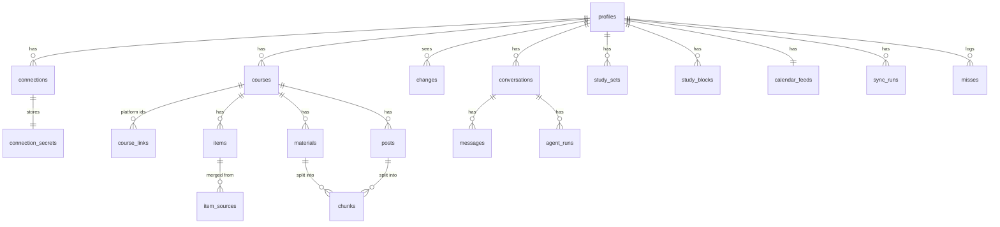

# S01 — Database schema (contract)

| | |
|---|---|
| **Status** | In progress (Neal): built + tested on `dev/neal`; awaiting B/C review |
| **Stage** | 0 |
| **Role** | A (writes), reviewed by B and C |
| **Depends on** | S00 |
| **Folders** | `supabase/migrations/`, `backend/app/db/` |

## Purpose
The single source of truth for all stored data. Sync (A) writes it, the agent and API (B) read it, the frontend (C) sees it through the API. **Changing it requires team agreement** ([AGENTS.md](../../AGENTS.md#contracts-change-only-with-whole-team-agreement)).

## Inputs
Requirements from [07](../07-sync-and-storage.md), [04](../04-citations-and-freshness.md), and specs S10–S34.

## Outputs
- `supabase/migrations/0001_init.sql` (extensions, enums, tables, indexes, RLS policies).
- `backend/app/db/models.py`: Pydantic models mirroring each table.
- Frontend never imports DB types directly; it uses API types (S02).

## Data model

## Enums
| Enum | Values |
|---|---|
| `platform` | `canvas`, `gradescope`, `echo360`, `piazza` |
| `record_status` | `active`, `changed`, `removed` |
| `connection_status` | `active`, `needs_reconnect`, `error`, `disconnected` |
| `item_type` | `assignment`, `exam`, `quiz`, `lab`, `project`, `other` |
| `material_kind` | `file`, `page`, `syllabus`, `transcript` |
| `post_kind` | `announcement`, `piazza`, `email` |
| `processing_status` | `pending`, `processing`, `done`, `failed`, `skipped` |
| `sync_trigger` | `schedule`, `connect`, `manual`, `agent` |
| `sync_status` | `queued`, `running`, `succeeded`, `failed`, `needs_reconnect` |
| `study_set_type` | `plan`, `quiz`, `flashcards` |
| `study_block_status` | `proposed`, `approved`, `declined` |

## Tables

**Common source columns** (on every row that comes from a platform: `course_links`, `item_sources`, `materials`, `posts`): `platform platform`, `platform_id text`, `source_url text`, `content_hash text`, `source_updated_at timestamptz null`, `last_synced_at timestamptz`, `status record_status default 'active'`, and a **unique `(user_id, platform, platform_id)`** used for upserts.

Every table has `user_id uuid not null references auth.users on delete cascade` (except where noted) and `created_at timestamptz default now()`.

### Identity and connections
| Table | Columns (beyond user_id, created_at) | Notes |
|---|---|---|
| `profiles` | `user_id pk`, `display_name text`, `timezone text default 'America/New_York'`, `model_choice text null` | Created on first API call (S20) |
| `connections` | `id uuid pk`, `platform`, `status connection_status`, `expires_at timestamptz null`, `last_sync_at timestamptz null`, `last_error text null`, `account_label text null` | unique `(user_id, platform)`. `expires_at` = Canvas token expiry |
| `connection_secrets` | `connection_id uuid pk references connections on delete cascade`, `ciphertext bytea`, `kind text` (`canvas_token` / `storage_state`) | Fernet-encrypted. **RLS: no access for any client role**; only the service role reads it |

### Courses and course content
| Table | Columns | Notes |
|---|---|---|
| `courses` | `id uuid pk`, `name text`, `code text` (e.g. `COMPSCI 311`), `term text`, `color text null` | One canonical course per real class |
| `course_links` | `id uuid pk`, `course_id`, + common source columns | One row per platform course (Canvas course, Gradescope course, Echo360 section) |
| `items` | `id uuid pk`, `course_id`, `type item_type`, `title text`, `description text null`, `due_at timestamptz null`, `points numeric null`, `status record_status`, `updated_at timestamptz` | Canonical merged item (S16) |
| `item_sources` | `id uuid pk`, `item_id uuid null` (set by merge), `course_id`, `raw_title text`, `raw_due_at timestamptz null`, `raw jsonb`, + common source columns | One row per platform record |
| `materials` | `id uuid pk`, `course_id`, `kind material_kind`, `title text`, `mime_type text null`, `storage_path text null`, `page_count int null`, `duration_s int null`, `recorded_at timestamptz null`, `version int default 1`, `processing_status processing_status`, `processing_error text null`, + common source columns | Files, pages, syllabus, Echo360 transcripts |
| `posts` | `id uuid pk`, `course_id`, `kind post_kind`, `title text`, `body text`, `author text null`, `posted_at timestamptz`, + common source columns | Announcements, Piazza, email |
| `chunks` | `id bigint generated always as identity pk`, `course_id`, `material_id uuid null`, `post_id uuid null`, `material_version int null`, `is_current bool default true`, `text text`, `page int null`, `start_s int null`, `end_s int null`, `token_count int`, `embedding vector(1536)`, `tsv tsvector generated always as (to_tsvector('english', text)) stored` | Check: exactly one of `material_id` / `post_id`. Old versions kept with `is_current=false` so past citations still resolve |
| `changes` | `id uuid pk`, `entity_type text` (`item`/`post`/`material`), `entity_id uuid`, `course_id`, `field text`, `old_value jsonb`, `new_value jsonb`, `detected_at timestamptz`, `seen_at timestamptz null` | Written by diff (S10) and merge (S16) |

### Agent, study and calendar
| Table | Columns | Notes |
|---|---|---|
| `conversations` | `id uuid pk`, `title text`, `updated_at` | |
| `messages` | `id uuid pk`, `conversation_id`, `role text` (`user`/`assistant`), `content jsonb` (`{text, citations[], study_set_ids[], block_ids[]}`) | Citations stored resolved (S23) |
| `agent_runs` | `id uuid pk`, `conversation_id`, `model text`, `status text` (`running`/`done`/`error`), `turns int`, `tool_calls jsonb`, `allowed_chunk_ids bigint[]`, `error text null`, `started_at`, `finished_at null` | Our own run log (no external tracing) |
| `study_sets` | `id uuid pk`, `course_id null`, `conversation_id null`, `type study_set_type`, `title text`, `payload jsonb` | Payload schema in S24 |
| `study_blocks` | `id uuid pk`, `run_id uuid null`, `course_id null`, `item_id null`, `title text`, `start_at`, `end_at`, `status study_block_status`, `decided_at null` | `proposed` until the student approves (S25) |
| `calendar_feeds` | `user_id pk`, `secret_token text unique`, `rotated_at` | ICS URL secret (S25) |
| `sync_runs` | `id uuid pk`, `platform`, `scope jsonb`, `trigger sync_trigger`, `status sync_status`, `stats jsonb` (`{new, changed, unchanged, removed}`), `error text null`, `queued_at`, `started_at null`, `finished_at null` | Powers freshness + `fetch_latest` waiting |
| `misses` | `id uuid pk`, `tool text`, `query text`, `course_id null` | Questions the DB couldn't answer |

### Indexes
- `items (user_id, due_at)`, `items (course_id)`
- `chunks` HNSW on `embedding vector_cosine_ops`; GIN on `tsv`; btree `(user_id, course_id, is_current)`
- `changes (user_id, detected_at desc)`, `posts (user_id, course_id, posted_at desc)`
- `sync_runs (user_id, platform, finished_at desc)`

## Behavior and rules
1. Extensions: `vector`, `pgcrypto`.
2. **RLS enabled on every table.** Policy for role `authenticated`: `select` where `user_id = auth.uid()`. No insert/update/delete policies for clients: all writes go through the backend with the service role.
3. Because the backend uses the service role (which bypasses RLS), **every repository function takes `user_id` and filters by it.** No repository function may query user data without it.
4. `connection_secrets`: RLS enabled with **no policies** (clients can never read it).
5. Deleting a user cascades everything; Storage objects under `users/{user_id}/` are deleted by the API's "delete my data" (S20).
6. Timestamps are UTC.

## Errors and edge cases
| Case | Expected behavior |
|---|---|
| Upsert of an existing `(user_id, platform, platform_id)` | Update in place (S10 decides changed vs unchanged by `content_hash`) |
| Chunk with both or neither parent | Rejected by check constraint |
| Embedding with wrong dimension | Rejected by column type |

## Acceptance criteria
- [x] `supabase db reset` applies migrations cleanly
- [x] Pydantic models exist for every table
- [x] RLS tests pass (below)
- [ ] Reviewed and approved by B and C before Stage 1

## Test plan
| ID | Test | Type |
|---|---|---|
| S01-T01 | Migrations apply on an empty DB | integration |
| S01-T02 | User A (authenticated JWT) cannot select User B's rows in every table | integration |
| S01-T03 | Authenticated client cannot insert/update/delete any table | integration |
| S01-T04 | No client role can select `connection_secrets` | integration |
| S01-T05 | Upsert on `(user_id, platform, platform_id)` updates instead of duplicating | integration |
| S01-T06 | Chunk check constraint rejects both/neither parent | integration |
| S01-T07 | Deleting a user cascades to all their rows | integration |
| S01-T08 | Vector search query on `chunks` uses the HNSW index (EXPLAIN) | integration |

## Out of scope
Piazza/email-specific fields beyond `posts` (stretch). Grades table (stretch).

## Implementation notes (2026-11-14, Neal)
- Migration: `supabase/migrations/0001_init.sql`. Models: `backend/app/db/models.py` (`TABLE_MODELS` maps table → model; a test checks columns match). Tests: `backend/tests/integration/test_s01_schema.py` (T01–T08 + model/column check), helpers in `tests/integration/db.py` (`AsUser` runs SQL as `authenticated`/`anon` with JWT claims, like PostgREST).
- Clarifications (no contract change): extensions live in schema `extensions` (Supabase default), so vector SQL uses `extensions.vector` / `<=>` (on the default search path). Clients get **only** `select` on user tables (`revoke all` from anon/authenticated, then `grant select` to authenticated) plus the RLS policy; `anon` can read nothing. Default privileges revoke client writes on future tables. `connection_secrets` has no grants and no policies.
- Small additions inside the spec's intent: check constraints on `connection_secrets.kind`, `changes.entity_type`, `messages.role`, `agent_runs.status`, `study_blocks.end_at > start_at`; `created_at` on every table; defaults for `sync_runs.stats/scope`; a few extra indexes (`item_sources.item_id`, `chunks.material_id/post_id`, `messages(conversation_id, created_at)`, `study_blocks(user_id, start_at)`).
- `chunks.embedding` is `not null` (every chunk is embedded before insert, S12).
