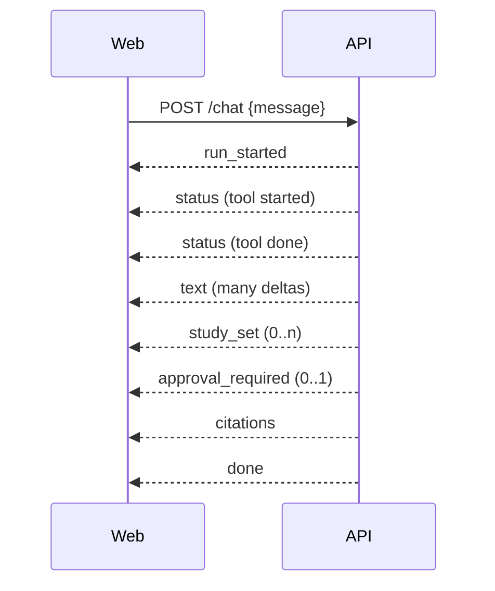

# S02 — API and streaming contract

| | |
|---|---|
| **Status** | Draft |
| **Stage** | 0 |
| **Role** | B (writes), reviewed by C |
| **Depends on** | S00, S01 |
| **Folders** | `backend/app/api/`, `backend/app/api/CONTRACT.md`, `apps/web/src/lib/api/` |

## Purpose
The only interface between the frontend (C) and the backend (B). Agreed in Stage 0 so C can build against mocks while B builds the real thing.

## Outputs
1. FastAPI route stubs with full request/response Pydantic models (returning seed-backed or mock data until implemented).
2. OpenAPI schema auto-generated by FastAPI → `make types` generates `apps/web/src/lib/api/schema.d.ts` (via `openapi-typescript`).
3. `backend/app/api/CONTRACT.md`: the SSE event spec below (OpenAPI can't describe SSE).
4. MSW mock handlers in `apps/web/tests/mocks/` matching this contract.

## Conventions
- Base URL `NEXT_PUBLIC_API_URL`. JSON everywhere except SSE and ICS.
- Auth: `Authorization: Bearer <Supabase access token>` on every endpoint except `/health` and `/calendar/{token}.ics` (S20).
- Times: ISO 8601 UTC strings. IDs: UUID strings, except `chunk_id` (integer).
- Errors: HTTP status + body `{"error": {"code": "<code>", "message": "<human text>", "retryable": false}}`.

| Error code | HTTP | Meaning |
|---|---|---|
| `unauthorized` | 401 | Missing/invalid JWT |
| `not_found` | 404 | Resource doesn't exist for this user |
| `validation_error` | 422 | Bad input (includes field details) |
| `invalid_token` | 400 | Canvas token rejected by Canvas |
| `platform_unavailable` | 502 | Platform error during validation |
| `rate_limited` | 429 | Too many chat requests |
| `conflict` | 409 | e.g. live login already in progress |
| `internal` | 500 | Unexpected |

## Endpoints

| Method + path | Request | Response | Spec |
|---|---|---|---|
| `GET /health` | — | `{status:"ok"}` | S20 |
| `GET /me` | — | `Me` | S20 |
| `PATCH /me` | `{timezone?, model_choice?, display_name?}` | `Me` | S34 |
| `DELETE /me/data` | — | `204` | S20 |
| `GET /models` | — | `{models: ModelOption[], default: string}` | S26 |
| `POST /connections/canvas` | `{token: string}` | `Connection` (+ initial sync queued) | S11 |
| `POST /connections/{platform}/login` | — | `{login_id, mode: "local"|"hosted", live_view_url?: string}` | S13 |
| `GET /connections/{platform}/login/{login_id}` | — | `{state: "pending"|"succeeded"|"failed"|"expired", error?}` | S13 |
| `DELETE /connections/{platform}` | — | `204` | S13 |
| `POST /sync` | `{platform?, course_id?}` | `{sync_run_ids: string[]}` | S10 |
| `GET /sync/status` | — | `{sources: SourceStatus[]}` | S10 |
| `GET /today` | `?date=YYYY-MM-DD` (optional) | `Today` | S32 |
| `GET /courses` | — | `CourseSummary[]` | S32 |
| `GET /courses/{id}` | — | `CourseDetail` | S32 |
| `GET /items` | `?course_id&type&from&to` | `Item[]` | S32 |
| `GET /changes` | `?since&unseen=true` | `Change[]` | S32 |
| `POST /changes/seen` | `{ids: string[]}` | `204` | S32 |
| `GET /citations` | `?ids=1,2,3` | `Citation[]` | S23 |
| `POST /chat` | `{conversation_id?: string, message: string}` | **SSE stream** | S22 |
| `GET /conversations` | — | `ConversationSummary[]` | S22 |
| `GET /conversations/{id}` | — | `{conversation, messages: Message[]}` | S22 |
| `GET /study-sets` | `?course_id` | `StudySetSummary[]` | S24 |
| `GET /study-sets/{id}` | — | `StudySet` | S24 |
| `POST /study-blocks/decision` | `{block_ids: string[], approve: boolean}` | `{blocks: StudyBlock[]}` | S25 |
| `GET /calendar/feed` | — | `{url: string}` | S25 |
| `POST /calendar/feed/rotate` | — | `{url: string}` | S25 |
| `GET /calendar/{token}.ics` | — (no auth) | `text/calendar` | S25 |

## Core response types (Pydantic → generated TS)
```text
Me            { user_id, display_name, timezone, model_choice, connections: Connection[] }
Connection    { platform, status, expires_at?, last_sync_at?, last_error?, account_label? }
SourceStatus  { platform, connection_status, last_sync_at?, running: bool, stale: bool }
ModelOption   { id, label, provider, tier: "recommended"|"experimental", available: bool }
CourseSummary { id, code, name, term, color?, upcoming_count, platforms: platform[] }
CourseDetail  CourseSummary + { items: Item[], recent_posts: Post[], materials: MaterialSummary[], syllabus_excerpt? }
Item          { id, course_id, course_code, type, title, due_at?, points?, status, sources: SourceRef[], changed_fields: string[] }
SourceRef     { platform, source_url, last_synced_at }
Post          { id, course_id, kind, title, excerpt, posted_at, source_url, status }
Change        { id, entity_type, entity_id, course_code, field, old_value, new_value, detected_at, seen: bool, summary: string }
Today         { date, timezone, overdue: Item[], due_today: Item[], due_this_week: Item[], upcoming_exams: Item[],
                changes: Change[], new_posts: Post[], sources: SourceStatus[] }
Citation      { chunk_id, title, kind, platform, course_code, page?, start_s?, end_s?, url, deep_link,
                quote, last_synced_at, status: "current"|"changed"|"removed"|"locked" }
Message       { id, role, text, citations: Citation[], study_set_ids: string[], block_ids: string[], created_at }
StudySet      { id, type, title, course_id?, payload, created_at }   // payload schema: S24
StudyBlock    { id, title, start_at, end_at, course_id?, item_id?, status }
```

## SSE stream: `POST /chat`

Transport: `text/event-stream`. Each event is `event: <type>` + `data: <json>`. The frontend reads it with `fetch` + a stream parser (not `EventSource`, which can't POST or send headers).



| Event | Data | When |
|---|---|---|
| `run_started` | `{run_id, conversation_id, user_message_id}` | First event, always |
| `status` | `{id, label, state: "started"|"done"|"failed", tool}` | Tool starts/finishes. `label` is human text, e.g. "Checking your CS 311 deadlines…" |
| `text` | `{delta: string}` | Answer text as it streams. May contain `[cite:chunk_123]` markers (frontend hides them until `citations` arrives) |
| `study_set` | `{study_set: StudySet}` | A study set was created and saved |
| `approval_required` | `{blocks: StudyBlock[], summary: string}` | Agent proposed study blocks; UI shows Add / Skip (S25) |
| `citations` | `{citations: Citation[], dropped: number[]}` | After the answer: resolved, validated citations. Frontend replaces markers with chips |
| `done` | `{run_id, message_id, final_text}` | Last event on success. `final_text` = cleaned text (invalid markers removed) |
| `error` | `{code, message, retryable}` | Last event on failure. Partial text already sent stays visible |

Ordering guarantees: `run_started` first; `citations` after the last `text`; exactly one terminal event (`done` or `error`).

## Behavior and rules
1. Any change to this file after Stage 0 needs B and C to agree, and updates the MSW mocks in the same PR.
2. Endpoint stubs return realistic data from seed (S03) so C is never blocked.
3. Pagination is not needed for MVP (lists are small); lists are capped at 200 items.

## Acceptance criteria
- [ ] All endpoints exist as stubs with typed models; OpenAPI renders at `/docs`
- [ ] `make types` generates TS types; web builds with them
- [ ] `CONTRACT.md` documents SSE events exactly as above
- [ ] MSW handlers cover every endpoint and a scripted SSE chat stream
- [ ] Approved by C

## Test plan
| ID | Test | Type |
|---|---|---|
| S02-T01 | OpenAPI schema contains every endpoint in the table | unit |
| S02-T02 | Error responses match the error envelope for 401/404/422 | integration |
| S02-T03 | SSE serializer emits `event:` + `data:` lines and valid JSON for each event type | unit |
| S02-T04 | SSE stream always ends with exactly one `done` or `error` | runtime |
| S02-T05 | Frontend SSE parser handles events split across network chunks | component |
| S02-T06 | MSW chat mock replays a full scripted stream and the parser reconstructs it | component |

## Out of scope
Pagination, websockets, public API for third parties (MCP server is stretch).
