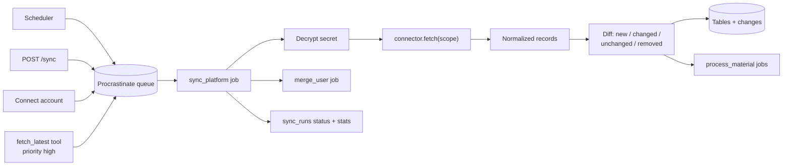

# S10 — Sync framework

| | |
|---|---|
| **Status** | Done (Neal) |
| **Stage** | 1 |
| **Role** | A |
| **Depends on** | S01 |
| **Folders** | `backend/app/sync/`, `backend/app/connectors/base.py`, `backend/app/core/crypto.py` |

## Purpose
The machinery every connector plugs into: job queue, scheduler, connector interface, the normalize → diff → store pipeline, secrets, and sync-run tracking. Scheduled sync and agent-triggered sync (`fetch_latest`) use **the same code path**; only trigger, priority and scope differ. Background: [07](../07-sync-and-storage.md).

## Inputs
- Job payload `SyncJob` (below), enqueued by: scheduler, `POST /sync`, connection setup (S11/S13), `fetch_latest` tool (S21).
- Connection secret (decrypted inside the worker only).

## Outputs
- Upserted rows in `course_links`, `item_sources`, `materials`, `posts` (S01).
- `changes` rows for changed fields; `status='removed'` for disappeared records (full scope only).
- `process_material` jobs for new/changed materials (S12); `merge_user` job after each sync (S16).
- A `sync_runs` row with status and stats.

## Interface
```python
# backend/app/connectors/base.py
class SyncScope(BaseModel):
    kind: Literal["full", "course", "item", "material"]
    course_platform_id: str | None = None   # required for course/item/material
    platform_id: str | None = None          # required for item/material

class ConnectorContext(BaseModel):
    user_id: UUID
    platform: Platform
    secret: SecretStr            # Canvas token or Playwright storage_state JSON
    last_success_at: datetime | None
    clock: Clock

# Normalized records: what every connector yields
class NCourse(BaseModel):   platform_id: str; name: str; code: str | None; term: str | None; source_url: str
class NItem(BaseModel):     platform_id: str; course_platform_id: str; type: ItemType; title: str
                            description: str | None; due_at: datetime | None; points: float | None
                            source_url: str; source_updated_at: datetime | None; raw: dict
class NMaterial(BaseModel): platform_id: str; course_platform_id: str; kind: MaterialKind; title: str
                            mime_type: str | None; download: DownloadRef | None; text: str | None
                            cues: list[TranscriptCue] | None; recorded_at: datetime | None
                            source_url: str; source_updated_at: datetime | None
class NPost(BaseModel):     platform_id: str; course_platform_id: str; kind: PostKind; title: str; body: str
                            author: str | None; posted_at: datetime; source_url: str; source_updated_at: datetime | None
NormalizedRecord = NCourse | NItem | NMaterial | NPost

class Connector(Protocol):
    platform: Platform
    async def validate(self, ctx: ConnectorContext) -> AccountInfo        # raises AuthExpired
    def fetch(self, ctx: ConnectorContext, scope: SyncScope) -> AsyncIterator[NormalizedRecord]

class AuthExpired(Exception): ...     # session/token no longer valid -> needs_reconnect
class PlatformError(Exception): ...   # transient; retry
```

```python
# backend/app/sync/jobs.py (Procrastinate tasks)
class SyncJob(BaseModel):
    user_id: UUID; platform: Platform; scope: SyncScope; trigger: SyncTrigger; sync_run_id: UUID

@app.task(queue="sync", retry=2)  async def sync_platform(job: SyncJob) -> None
@app.task(queue="process")        async def process_material(user_id: UUID, material_id: UUID) -> None  # S12
@app.task(queue="sync")           async def merge_user(user_id: UUID) -> None                           # S16

def enqueue_sync(user_id, platform, scope, trigger) -> UUID   # creates sync_runs row, returns its id
async def wait_for_sync(sync_run_id, timeout_s=15) -> SyncRunResult  # used by fetch_latest
```

## Data flow


## Behavior and rules
1. **Queueing lock** per `(user_id, platform, scope key)`: if an identical job is queued or running, `enqueue_sync` returns the existing `sync_run_id` instead of adding another.
2. **Priorities:** `agent` and `manual` triggers run before `schedule` and `connect`.
3. **Schedule** (Procrastinate periodic tasks): Canvas every 20 min, Gradescope every 60 min, Echo360 daily at 06:00 ET, for every `active` connection. Skip if the last successful sync is newer than the interval.
4. **Diff** per record, keyed by `(user_id, platform, platform_id)`:
   - not found → insert (`status=active`), stats.new++
   - found, `content_hash` differs → update, write one `changes` row per changed meaningful field (`title`, `due_at`, `points`, `body`, `description`), `status=changed`, stats.changed++
   - found, same hash → only `last_synced_at` updated, stats.unchanged++
   - `content_hash` = SHA-256 of a canonical JSON of the meaningful fields (not timestamps of syncing).
5. **Removal only on full scope:** after a successful `full` fetch, records of that platform not seen in this run are set `status=removed` (+ `changes` row). Narrow scopes never remove anything.
6. A material is (re)queued for `process_material` when new, or when `content_hash` / `source_updated_at` changed.
7. **Errors:** `AuthExpired` → connection `needs_reconnect`, sync run `needs_reconnect`, no retry. `PlatformError` → retry with backoff (2 retries). Any other exception → run `failed`, `connections.last_error` set.
8. **Secrets:** `core/crypto.py` encrypts/decrypts with Fernet (`ENCRYPTION_KEY`). Plaintext secrets never logged, never returned by the API, never passed to agent code.
9. `GET /sync/status` returns per-platform `last_sync_at`, `running`, and `stale` (older than 2× interval).
10. Per-record failures (one bad record) are logged and skipped; they don't fail the run.

## Errors and edge cases
| Case | Expected behavior |
|---|---|
| Two `fetch_latest` calls for the same course at once | One job; both callers wait on the same `sync_run_id` |
| Scheduled full sync running when agent asks for one course | Agent's narrow job queued separately with higher priority (different scope key) |
| Connector yields a record for an unknown course | Create `course_links` + canonical course first (S16 assigns/merges) |
| Worker crashes mid-run | Procrastinate retries; diff is idempotent so re-running is safe |
| Encryption key missing | Worker refuses to start |

## Acceptance criteria
- [x] A fake connector (test double) can be synced end to end into the DB
- [x] Re-running the same sync produces only `unchanged` stats
- [x] Changing one field produces exactly one `changes` row
- [x] `wait_for_sync` returns within timeout with final status
- [ ] `/sync/status` reflects running and finished runs

## Test plan
| ID | Test | Type |
|---|---|---|
| S10-T01 | `content_hash` is stable across key order and ignores sync timestamps | unit |
| S10-T02 | Diff classifies new / changed / unchanged correctly | unit |
| S10-T03 | Changed `due_at` writes one `changes` row with old and new values | integration |
| S10-T04 | Full scope marks unseen records `removed`; narrow scope never does | integration |
| S10-T05 | Queueing lock: duplicate enqueue returns the same `sync_run_id` | integration |
| S10-T06 | Agent-trigger job runs before queued schedule jobs | integration |
| S10-T07 | `AuthExpired` sets connection `needs_reconnect`, no retry | integration |
| S10-T08 | `PlatformError` retries twice then fails the run | integration |
| S10-T09 | `wait_for_sync` times out cleanly and reports `running` | integration |
| S10-T10 | Fernet round-trip; ciphertext never equals plaintext; wrong key fails | unit |
| S10-T11 | One malformed record is skipped, run still succeeds | integration |
| S10-T12 | New/changed material enqueues `process_material`; unchanged does not | integration |

## Out of scope
Platform-specific fetching (S11, S14, S15), file parsing (S12), cross-platform merge (S16).

## Implementation notes (2026-11-14, Neal)
- Code: `connectors/base.py` (interface + registry), `core/crypto.py`, `sync/diff.py`, `sync/pipeline.py` (`run_sync`), `sync/jobs.py` (Procrastinate app, `enqueue_sync`, `wait_for_sync`, periodic `schedule_syncs` every 5 min), `db/repositories/sync.py`, `uv run app worker` / `make worker`.
- Queue schema: `supabase/migrations/0002_procrastinate.sql` (procrastinate 3.11.0 schema verbatim + lockdown: RLS on, no client grants, function EXECUTE revoked from anon/authenticated).
- Queueing lock is done on **our** `sync_runs` (advisory lock + "open run with same scope" lookup), so duplicate callers get the same `sync_run_id`. Priority: agent/manual 10, schedule/connect 0.
- Records are stored one transaction each (bad record skipped, rule 10). Item-field change rows: see S16 below.
- `merge_user` (after each successful sync) now runs the real **S16** merge (`sync/merge.py`). **S16 owns item change rows**: the pipeline writes change rows only for posts and materials; canonical item changes (title/due/points, all-sources-removed) come from S16. Once courses merge, only Canvas (or a course with no Canvas link) renames the canonical course.
- `process_material` is a stub until S12. `GET /sync/status` / `POST /sync` route wiring happens with the API DB wiring (B lane).
- **Incomplete listings** (found while building S11): connectors add `(course_platform_id, table)` to `ctx.incomplete` for windowed or hidden sections (Canvas: announcements are a 60-day window; a 403 tab). Full-scope removal skips those course/table pairs, so old announcements and hidden tabs are never marked `removed`. Test S10-T04b.
- S12 extended the pipeline: new/changed materials carry their `download`/`text`/`cues` payload to `process_material`, and new/changed posts are queued for `process_post`.

## Demo hardening (2026-11-14, Neal)
- Dashboard merges use manual-refresh priority (10), ahead of bulk file jobs. Import status includes pending/active merge jobs. Unreadable encrypted credentials terminate as `needs_reconnect` instead of remaining queued (regression in `test_s10_sync_db.py`).


## Post-hackathon amendment — S43 (review branch)

An observed removed source becomes present independently of its content hash. Identical return counts as unchanged, preserves saved material version/chunks/processing status, and does not requeue indexing solely for restoration. Posts/materials emit one status-back change; item alerts remain canonical merge's responsibility. Changed returning course links also become active. Missing/failed indexing remains the next independent recovery spec. See [S43](S43-source-presence-restoration.md).
