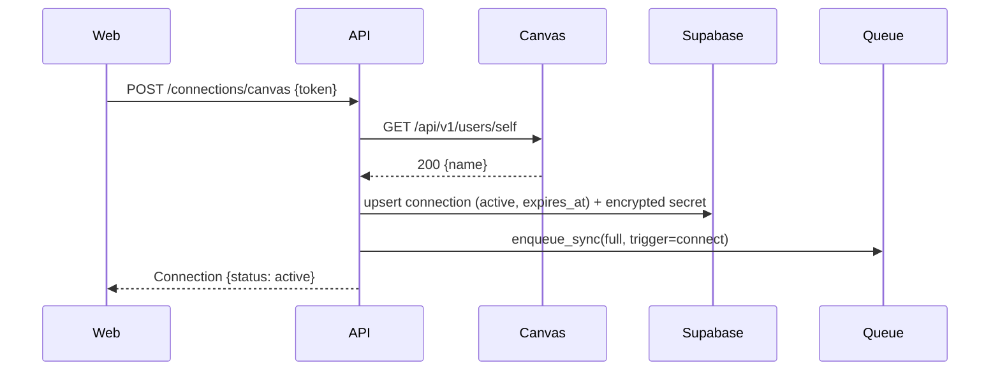

# S11 — Canvas connector

| | |
|---|---|
| **Status** | Draft |
| **Stage** | 1 |
| **Role** | A |
| **Depends on** | S10 |
| **Folders** | `backend/app/connectors/canvas/`, `backend/app/api/routes/connections.py` (the `POST /connections/canvas` handler, coordinated with B) |

## Purpose
Pull courses, assignments, quizzes, exams (calendar events), announcements, files and syllabi from Canvas with the student's personal access token, as normalized records for the pipeline (S10). Background: [02](../02-integrations-and-auth.md#method-1-canvas-token).

## Inputs
- `ConnectorContext` with the Canvas token (S10).
- `CANVAS_BASE_URL` (default `https://umass.instructure.com`).
- `SyncScope`: `full`, `course`, `item` (assignment id), `material` (file id).

## Outputs
`NCourse`, `NItem`, `NMaterial` (files + syllabus), `NPost` (announcements). File downloads happen in S12 using a `DownloadRef` that carries the API file URL (token added by the worker at download time).

## Interface
```python
class CanvasClient:                      # thin httpx wrapper
    def __init__(self, base_url: str, token: SecretStr, http: httpx.AsyncClient): ...
    async def get(self, path: str, params: dict | None = None) -> Any            # single page
    def paginate(self, path: str, params: dict | None = None) -> AsyncIterator[Any]  # follows Link rel="next"
    # There is NO post/put/delete method. Any non-GET request raises ForbiddenMethod.

class CanvasConnector(Connector):
    platform = "canvas"
    async def validate(self, ctx) -> AccountInfo          # GET /api/v1/users/self
    def fetch(self, ctx, scope) -> AsyncIterator[NormalizedRecord]
```

## Canvas API calls (all GET)
| Data | Endpoint | Notes |
|---|---|---|
| Validate | `/api/v1/users/self` | 401 → `invalid_token` |
| Courses | `/api/v1/courses?enrollment_state=active&include[]=term&per_page=100` | Skip courses without a name or with `access_restricted_by_date` |
| Syllabus | `/api/v1/courses/:id?include[]=syllabus_body` | HTML → text; `NMaterial(kind="syllabus")` |
| Assignments | `/api/v1/courses/:id/assignments?per_page=100&order_by=due_at` | Includes quizzes (`is_quiz_assignment`) |
| Calendar events | `/api/v1/calendar_events?type=event&context_codes[]=course_:id&start_date=<term start>&end_date=<+120d>&per_page=100` | Exams are often events, not assignments |
| Announcements | `/api/v1/announcements?context_codes[]=course_:id&start_date=<-60d>&per_page=100` | `NPost(kind="announcement")` |
| Files | `/api/v1/courses/:id/files?per_page=100&sort=updated_at` | 403 if the Files tab is hidden → fall back to modules |
| Modules (fallback) | `/api/v1/courses/:id/modules?include[]=items&per_page=100` then `/api/v1/courses/:id/files/:file_id` for `File` items | |

## Mapping rules
1. `source_url` = Canvas `html_url` (never a download URL).
2. **Item type:** `is_quiz_assignment` → `quiz`; title matches `/\b(midterm|exam|final)\b/i` → `exam`; `/\blab\b/i` → `lab`; `/\bproject\b/i` → `project`; else `assignment`. Calendar events become `NItem` only if the title matches the exam pattern (other events ignored for MVP).
3. `due_at`: Canvas `due_at` (UTC). If null and `lock_at` exists, keep `due_at` null (don't guess).
4. `course.code`: Canvas `course_code` normalized (`COMPSCI 311 SEC 01` → `COMPSCI 311`).
5. Announcements: `message` HTML → plain text (keep links as text); `posted_at`.
6. Files: only `pdf`, `pptx`, `docx`, `txt`, `md`, `html` produce materials; others ignored. `source_updated_at` = file `updated_at`.
7. **Incremental:** on `full` scope after the first sync, announcements use `start_date = last_success_at - 1 day`; everything else is listed fully (cheap) and the diff (S10) skips unchanged.
8. **Rate limits:** respect `X-Rate-Limit-Remaining`; if below 50, sleep 1 s between requests. Max 4 concurrent requests per user.
9. `item` / `material` scope fetches only that one object (`/courses/:c/assignments/:id`, `/courses/:c/files/:id`).

## `POST /connections/canvas` flow

`expires_at`: Canvas doesn't return token expiry via `/users/self`. The UI does **not** ask the student (non-technical rule); the API stores `expires_at = now + 90 days` (the guide tells students to pick the longest expiry) and Settings shows a renewal reminder before then. The optional `expires_at` field stays for a future "detect expiry" improvement.

## Errors and edge cases
| Case | Expected behavior |
|---|---|
| Token invalid/expired (401) | Validation → `400 invalid_token`; during sync → `AuthExpired` |
| One course returns 403 for files | Use modules fallback; if that also fails, skip files for that course and record a warning in run stats |
| Assignment with no due date | `due_at=null`; still synced (appears under "No due date") |
| Huge course (1000+ files) | Paginate; cap 500 files per course for MVP (log if capped) |
| Canvas 5xx / timeout | `PlatformError` (retried by S10) |

## Example
Canvas assignment `{"id": 99812, "name": "Midterm 1", "due_at": "2026-11-21T00:00:00Z", "html_url": "https://umass.instructure.com/courses/12345/assignments/99812", "points_possible": 100, "is_quiz_assignment": false, "updated_at": "2026-11-10T14:02:00Z"}` →
`NItem(platform_id="99812", course_platform_id="12345", type="exam", title="Midterm 1", due_at=2026-11-21T00:00Z, points=100, source_url=".../assignments/99812", source_updated_at=2026-11-10T14:02Z)`

## Acceptance criteria
- [ ] Paste a real token → courses, items, announcements, files appear in the DB within 2 minutes
- [ ] Client is provably GET-only
- [ ] All mapping rules covered by fixture tests
- [ ] Fixtures are scrubbed of personal data

## Test plan
| ID | Test | Type |
|---|---|---|
| S11-T01 | `CanvasClient` raises on any non-GET method | unit |
| S11-T02 | Pagination follows `Link rel="next"` across 3 pages | connector |
| S11-T03 | Course code normalization (sections, extra spaces) | unit |
| S11-T04 | Item type mapping: quiz, exam (title), lab, project, assignment | unit |
| S11-T05 | Calendar event "Midterm 1" → exam item; "Office hours" → ignored | connector |
| S11-T06 | Announcement HTML → clean text with links preserved as text | unit |
| S11-T07 | Files 403 → modules fallback yields the file materials | connector |
| S11-T08 | Unsupported file types are skipped | connector |
| S11-T09 | 401 during validate → `invalid_token`; during fetch → `AuthExpired` | connector |
| S11-T10 | `item` scope fetches exactly one assignment | connector |
| S11-T11 | Rate-limit header below threshold triggers throttling | connector |
| S11-T12 | `POST /connections/canvas` stores encrypted token and enqueues a `connect` sync | integration |

## Out of scope
Grades/submissions, discussions (non-announcement), Canvas pages, quizzes' question contents, writing anything to Canvas.
