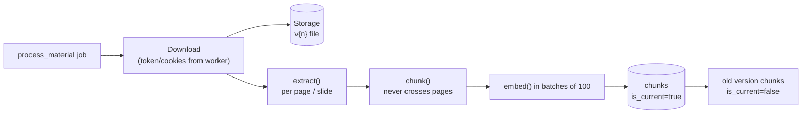

# S12 — File processing and embeddings

| | |
|---|---|
| **Status** | Done (pending merge; real-course file check open) |
| **Stage** | 1 |
| **Role** | A |
| **Depends on** | S10 |
| **Folders** | `backend/app/sync/processing/`, `backend/app/core/embeddings.py` |

## Purpose
Turn materials (PDFs, slides, documents, syllabi, transcripts) and posts into **chunks with embeddings** that search (S21) and citations (S23) rely on. Each chunk keeps its exact anchor (page or timestamp) so citations point to the right place.

## Inputs
- `process_material(user_id, material_id)` job (S10). Also called for posts: `process_post(user_id, post_id)`.
- Material row + `DownloadRef` / inline `text` / transcript `cues`.

## Outputs
- Original file in Supabase Storage at `users/{user_id}/{platform}/{course_platform_id}/{platform_id}/v{version}.{ext}`.
- `chunks` rows (`is_current=true`) for the new version; previous version's chunks set `is_current=false`.
- `materials.processing_status` = `done` / `skipped` / `failed` (+ `processing_error`), `page_count` / `duration_s`.

## Interface
```python
class Extracted(BaseModel):
    units: list[Unit]                 # one per page / slide / transcript cue window / post
class Unit(BaseModel):
    text: str; page: int | None = None; start_s: int | None = None; end_s: int | None = None

def extract(mime_type: str, data: bytes) -> Extracted          # PDF, PPTX, DOCX, HTML, TXT/MD
def extract_transcript(cues: list[TranscriptCue]) -> Extracted  # VTT-like cues
def chunk(units: list[Unit], max_tokens=500, overlap_tokens=60, min_tokens=40) -> list[ChunkDraft]

class EmbeddingProvider(Protocol):
    dim: int                                            # 1536
    async def embed(self, texts: list[str]) -> list[list[float]]
# GeminiEmbeddings (DEFAULT): "gemini-embedding-001" via the OpenAI-compatible endpoint
#   (https://generativelanguage.googleapis.com/v1beta/openai/), dimensions=1536, then L2-normalize
#   (Google only pre-normalizes 3072-dim output). Use task type "retrieval document" for chunks and
#   "retrieval query" for questions if the endpoint supports it.
# OpenAIEmbeddings ("text-embedding-3-small", 1536 dims) as an alternative; FakeEmbeddings (deterministic, tests)
# Never mix providers in one database: switching provider means re-embedding everything.
```

## Data flow


## Behavior and rules
1. **Extraction by type:** PDF → PyMuPDF, one unit per page. PPTX → python-pptx, one unit per slide (title + body + speaker notes). DOCX/HTML → markitdown, units split on headings (page = null). TXT/MD → one unit. Transcript → windows of ~60 s of cues (`start_s`, `end_s`). Post → one unit (title + body).
2. **Chunking never crosses a page/slide/window boundary**, so every chunk has one anchor. Long units are split at sentence boundaries into ≤ `max_tokens` with `overlap_tokens` overlap. Units under `min_tokens` are merged with the **next unit on the same page** only; otherwise kept as is.
3. Each chunk's stored `text` is prefixed with a short context header for embedding quality: `"[COMPSCI 311 · Lecture 7 slides · p.12]\n"` (header included in `text` so search and citation quotes match).
4. Token counting uses `tiktoken` (`cl100k_base`) consistently.
5. **Limits:** files > 50 MB or > 500 pages → `skipped` with reason. No extractable text (scanned PDF) → `skipped` ("no text; OCR out of scope").
6. **Versioning:** when a material changes, increment `version`, store the new file, insert new chunks, then flip old chunks to `is_current=false` in the same transaction (search never sees a half-updated material).
7. Embedding calls are batched (100 texts), retried on 429/5xx with backoff; total failure → `failed`, material stays searchable by its previous version.
8. Untrusted text is stored as-is; wrapping for prompts happens at tool level (S21).

## Errors and edge cases
| Case | Expected behavior |
|---|---|
| Corrupt/password-protected PDF | `failed` with error; doesn't crash the worker |
| PPTX slide with only an image | Unit with title only; if empty, skipped (no empty chunks) |
| Same file content re-uploaded (same hash) | No reprocessing |
| Download 401/403 (expired token/session) | `AuthExpired` → connection `needs_reconnect` |

## Example
`Lecture7.pptx`, slide 12 text "Memoization stores solutions to subproblems…" (180 tokens) → one chunk `{page: 12, text: "[COMPSCI 311 · Lecture 7 slides · p.12]\nMemoization stores…", token_count: 195, embedding: [...]}`.

## Acceptance criteria
- [ ] A real lecture PDF and PPTX from our own courses produce chunks with correct page numbers
- [x] Re-processing an unchanged file does nothing; a changed file produces a new version with old chunks non-current
- [x] Fake embeddings used in all tests

## Test plan
| ID | Test | Type |
|---|---|---|
| S12-T01 | PDF extraction yields one unit per page with correct page numbers | unit |
| S12-T02 | PPTX extraction includes title, body and notes per slide | unit |
| S12-T03 | Chunker never produces a chunk spanning two pages | unit |
| S12-T04 | Long unit splits at sentence boundaries with overlap; all ≤ max_tokens | unit |
| S12-T05 | Tiny units merge only within the same page | unit |
| S12-T06 | Transcript cues become ~60 s windows with start/end seconds | unit |
| S12-T07 | Context header is prefixed and included in token count | unit |
| S12-T08 | Scanned (image-only) PDF → `skipped` | unit |
| S12-T09 | New version: new chunks current, old chunks non-current, atomically | integration |
| S12-T10 | Embedding provider retries on 429 then succeeds | unit |
| S12-T11 | FakeEmbeddings deterministic, 1536-dim, normalized | unit |

## Out of scope
OCR, images/diagrams understanding, audio transcription (Echo360 fallback via speech-to-text is stretch).

## Implementation notes (2026-11-14, Neal)
- Code: `backend/app/sync/processing/` — `extract.py` (`extract`, `extract_transcript`, `Unit`, `Extracted`, limits), `chunker.py` (`chunk(..., context="CODE · Title")`, `count_tokens`), `process.py` (`process_material`, `process_post`, `MaterialSource`), `storage.py` (`SupabaseStorage`, `http_downloader`, `storage_path`, **`delete_user_files(user_id)`** for S20), `worker.py` (job glue: decrypts the Canvas token, builds downloader/storage/embeddings).
- **Embeddings decision:** Gemini `gemini-embedding-001` via the OpenAI-compatible endpoint at **1536 dims**, L2-normalized (`core/embeddings.py`, matches `vector(1536)`); `FakeEmbeddings` in all tests. Batches of 100; 429/5xx retried with backoff (S12-T10).
- **DOCX/HTML without markitdown** (too heavy: many transitive deps): stdlib `zipfile`+XML for DOCX and `html.parser` for HTML, split on headings. Same behavior as the spec, fewer deps.
- **Download refs reach the job through its payload:** `materials` has no download-URL column, so `run_sync` now passes `source = {download, text, cues}` (from the `NMaterial`) to `process_material(user_id, material_id, source)`. Canvas pages arrive as inline `text` (HTML) and transcripts as `cues`; neither stores an original file.
- **Posts:** `run_sync(..., process_post=...)` queues a `process_post` job for new/changed posts; one unit `title\nbody` (HTML stripped), header `[CODE · Announcement · Title]` (same as S03 seed). Old post chunks are flipped to non-current, not deleted.
- Header format matches the seed: `[CODE · Title · p.N]`, `[CODE · Title · m:ss]` for transcripts, `[CODE · Title]` when there's no anchor. The header counts toward `max_tokens`.
- Versioning: first processing keeps `version` (1); any later processing that yields different chunk text bumps it. Identical chunk text → `unchanged` (no storage write, no embedding). Chunks are inserted then older current chunks flipped in **one transaction**; embedding/storage happen before it, so a failure leaves the previous version searchable (`processing_status = failed`).
- Storage: Storage REST API with `SUPABASE_SERVICE_ROLE_KEY`; bucket `materials` (private) is created on the first "Bucket not found". Without a service key the worker still processes but doesn't keep the original file.
- Download 401/403 → `AuthExpired` → connection `needs_reconnect`, material `failed` ("Your sign-in for this site expired."). 5xx/timeouts → `PlatformError` → job retried (2 attempts).
- PyMuPDF is **AGPL-3.0** (fine for our public repo; listed in THIRD_PARTY_NOTICES). Swap for `pypdf` if that ever matters.
- Open: acceptance check with a real lecture PDF/PPTX from our own courses (needs a live Canvas sync).


## Post-hackathon amendment — S45 (review branch)

Material failures raise safe classified exceptions after recording failed state, preserving old chunks. Retryable failures are PlatformError for legacy compatibility; new intents own durable bounded retry/backoff. Single-file401/403 is SourceAccessError (file unavailable), not automatic whole-grant expiry; verified AuthExpired retains reconnect handling. Binary-original Storage configuration is required for downloads. Worker embedding retries are owned by the intent policy. See [S45](S45-processing-retries-and-recovery.md).
