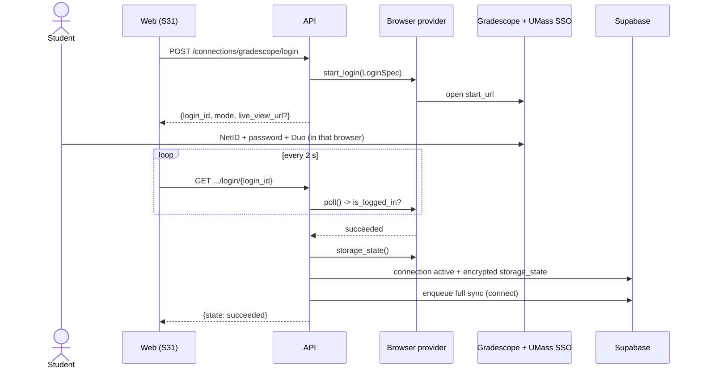

# S13 — Browser sessions and live login

| | |
|---|---|
| **Status** | Draft |
| **Stage** | 2 |
| **Role** | A (backend); C builds the UI in S31 |
| **Depends on** | S10 |
| **Folders** | `backend/app/connectors/browser/`, `backend/app/api/routes/connections.py` |

## Purpose
Let a student log in to platforms without an API (Gradescope, Echo360, Piazza) **once**, through a real browser we control, approving Duo on their phone. We save the browser's session (cookies) encrypted and reuse it for syncing. We never see or store the password. Background: [02](../02-integrations-and-auth.md#method-2-cloud-browser-session).

## Inputs
- `POST /connections/{platform}/login` from the UI.
- `BROWSER_PROVIDER`: `local` or `hosted`.

## Outputs
- `connections` row `active` + `connection_secrets(kind="storage_state")` (Playwright storage state JSON, encrypted).
- Initial `full` sync enqueued (trigger `connect`).
- Login status for UI polling: `pending` → `succeeded` | `failed` | `expired`.

## Two provider modes
| Mode | How the student sees the login | Use |
|---|---|---|
| `local` (**MVP**) | Worker opens a **visible Chromium window** on the machine running it. In the demo that's our laptop, so the window appears on screen | Dev + demo; zero infrastructure |
| `hosted` (stretch) | A hosted cloud-browser service runs the browser; the UI embeds its **live-view URL** in an iframe | Real deployment |

Both implement the same interface, so the rest of the system doesn't care.

## Interface
```python
class LoginSpec(BaseModel):          # defined per platform in its connector
    platform: Platform
    start_url: str                    # e.g. https://www.gradescope.com/login
    is_logged_in: Callable[[Page], Awaitable[bool]]   # e.g. account menu present, URL not /login
    timeout_s: int = 300

class BrowserProvider(Protocol):
    async def start_login(self, spec: LoginSpec) -> LoginHandle            # {login_id, live_view_url | None}
    async def poll(self, handle: LoginHandle) -> LoginState                 # pending/succeeded/failed/expired
    async def storage_state(self, handle: LoginHandle) -> dict              # after success
    async def close(self, handle: LoginHandle) -> None
    async def open_with_state(self, state: dict) -> BrowserContext          # for syncing (headless)

async def check_session(platform, state) -> bool   # load state, open a known page, detect login redirect
```

## Data flow


## Behavior and rules
1. One active login per `(user, platform)`; a second request while pending → `409 conflict`.
2. Login expires after `timeout_s` (5 min) → `expired`, browser closed.
3. **We never read form fields or keystrokes.** Detection uses page state only (`is_logged_in`).
4. Storage state is encrypted immediately (S10 crypto) and the in-memory copy discarded after saving.
5. Sync jobs open a **headless** context with the saved state. If `check_session` fails or a page redirects to a login URL → `AuthExpired` → `needs_reconnect` (S10).
6. `DELETE /connections/{platform}` deletes the secret and connection, and cancels queued jobs for it.
7. Login state lives in memory in the API process for MVP (single instance). Documented limitation.
8. Respect platform load: one browser context per user at a time; reuse it across pages in one sync.

## Errors and edge cases
| Case | Expected behavior |
|---|---|
| Student closes the window | `failed` ("window closed") |
| Duo denied / timed out | Stays `pending` until timeout → `expired` |
| SSO flags the data-center IP (hosted mode) | `failed` with message; documented in open questions |
| Session saved but immediately invalid | First sync → `needs_reconnect`; UI shows Reconnect |

## Acceptance criteria
- [ ] Local mode: clicking Connect Gradescope opens a window; after login + Duo the UI shows "connected" and a sync starts
- [ ] Saved state lets a headless sync fetch the course list
- [ ] Expired state is detected and surfaces as `needs_reconnect`

## Test plan
| ID | Test | Type |
|---|---|---|
| S13-T01 | Login state machine: pending → succeeded when `is_logged_in` becomes true | unit (fake page) |
| S13-T02 | Timeout → expired and browser closed | unit |
| S13-T03 | Second concurrent login → 409 | integration |
| S13-T04 | Storage state is stored encrypted, never in plaintext columns or logs | integration |
| S13-T05 | `check_session` returns false when a page redirects to the login URL | unit (fake page) |
| S13-T06 | Disconnect deletes the secret and cancels queued jobs | integration |
| S13-T07 | Manual: real Gradescope login via local mode works end to end | manual |

## Out of scope
Hosted live-view implementation (stretch), extension-based login, storing passwords, automating Duo.

## Stretch: one "Connect my UMass account" login (after MVP)
Goal for non-technical students: no Canvas token at all. One live login to UMass SSO (NetID + Duo) whose single-sign-on session is reused to sign in to Canvas, Gradescope ("School credentials") and Echo360 (launched from Canvas) in the same browser context, saving one storage state per platform. Canvas data would then be read with the session instead of a token. **Spike first** (record results here): does one Duo approval carry over to all three? Does Canvas's API accept the session for GET requests from the worker? Until then the MVP keeps the guided Canvas token (S11, S31).
