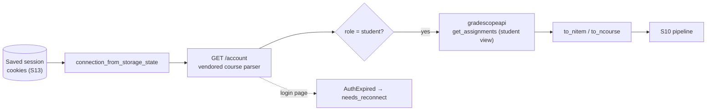

# S14 — Gradescope connector

| | |
|---|---|
| **Status** | Draft |
| **Stage** | 2 |
| **Role** | A |
| **Depends on** | S13 |
| **Folders** | `backend/app/connectors/gradescope/` (+ `_vendored/` for copied code) |
| **Reuses** | [`gradescopeapi`](https://github.com/nyuoss/gradescope-api) 1.8.x (MIT, PyPI dependency) and helpers from [gradescope-mcp](https://github.com/Yuanpeng-Li/gradescope-mcp) @ `f8a46c8` (MIT, vendored). Review: [research/mcp-servers-review.md](../research/mcp-servers-review.md) |

## Purpose
Read the student's Gradescope courses and assignments (release/due dates, submission status) using the saved browser session from the UMass login (S13). **Borrow, don't rebuild:** the parsing comes from `gradescopeapi`'s student view and gradescope-mcp's hardened helpers; we only replace **password login with our saved session cookies** and map results into our normalized records. Fixed code; no AI browsing; students never see any of this.

## Inputs
- `ConnectorContext` with the encrypted Playwright storage state (cookies) from S13.
- `SyncScope`: `full` or `course`.

## Outputs
- `NCourse` per Gradescope course where the student's role is `student` (`source_url` = course page).
- `NItem` per assignment: `type` (S11 rule 2 mapping), `title`, `due_at`, `source_url` = assignment page, `raw` = `{released_at, late_due_at, submission_status, score?, max_score?}`.

## What we reuse (and where it goes)
| Piece | From | How |
|---|---|---|
| `GSConnection` / `Account` objects, `get_assignments_student_view` parser, `Assignment` model | `gradescopeapi` (PyPI) | Dependency in `backend/pyproject.toml` |
| Course-list parser that groups by role (`_parse_account_courses`, `_role_for_heading`) | gradescope-mcp `tools/courses.py` | Copy to `_vendored/courses.py` |
| Logged-out / session-expiry detection (`_is_logged_out_page`, `_has_login_form`, `_expiry_reason`) | gradescope-mcp `auth.py` | Copy to `_vendored/auth_checks.py` |
| Timezone-aware date parsing (`_format_utc_offset`, `parse_date_input`) | gradescope-mcp `tools/assignments.py` | Copy only if `gradescopeapi`'s dates lack offsets |
| **Not** used: password login, the MCP server, all instructor/grading/write tools, the local cache | | |

**Vendoring rules:** each copied file starts with a header `# Vendored from <repo> @ <commit>, <path>, MIT License, (c) <author>. Modified: <what>.`; the upstream LICENSE text is copied to `_vendored/LICENSE-gradescope-mcp`; every reused piece is listed in [THIRD_PARTY_NOTICES.md](../../THIRD_PARTY_NOTICES.md) and the Devpost credits.

## Interface
```python
GRADESCOPE_LOGIN = LoginSpec(platform="gradescope", start_url="https://www.gradescope.com/login",
                             is_logged_in=<course list present on /account>)

def connection_from_storage_state(state: dict) -> GSConnection
    # New gradescopeapi GSConnection; load the gradescope.com cookies from the Playwright storage
    # state into conn.session (requests); set the CSRF header from the page; mark logged in.
    # Never calls gradescopeapi's password login.

class GradescopeConnector(Connector):
    platform = "gradescope"
    async def validate(self, ctx) -> AccountInfo         # GET /account; logged-out page -> AuthExpired
    def fetch(self, ctx, scope) -> AsyncIterator[NormalizedRecord]

# Pure functions (fixture-tested)
def parse_course_list(html: str) -> list[GsCourse]       # wraps vendored _parse_account_courses; keeps role
def to_ncourse(c: GsCourse) -> NCourse
def to_nitem(a: gradescopeapi.Assignment, course_platform_id: str, tz: str) -> NItem
def check_logged_in(response_html: str, url: str) -> None   # vendored checks; raises AuthExpired
```

## Data flow


## Behavior and rules
1. **Spike first (≤ 1 h, record result here):** does a `GSConnection` with injected cookies fetch `/account` and a student course page? If not, fall back to Playwright navigation with the saved state and feed the HTML to the same parsers (the parsers don't care how HTML was fetched).
2. Only courses where the student's role is **student** are synced; staff courses are ignored.
3. Dates: use `gradescopeapi`'s parsed datetimes; if naive, interpret in `America/New_York`. Never guess an unparseable date (`due_at=null` + warning).
4. `platform_id`: Gradescope's numeric course/assignment IDs.
5. Throttle: ≤ 1 request/second per user; one connection per user per sync.
6. Logged-out page or redirect to `/login` on any request → `AuthExpired` (S10 marks `needs_reconnect`; UI says "Reconnect Gradescope").
7. Parser failure (layout changed) → `PlatformError("layout_changed")`; save the HTML to `backend/tests/fixtures/_debug/` (git-ignored) for a quick fix.
8. **Read-only:** the connector never calls any `gradescopeapi` method that writes (uploads, extensions, grading).

## Errors and edge cases
| Case | Expected behavior |
|---|---|
| Course with zero assignments | Course synced, no items |
| Assignment without a due date | `due_at=null` |
| Late due date present | `raw.late_due_at`; `due_at` = regular due date |
| Student is also a TA in another course | Only student-role courses synced |
| `gradescopeapi` upstream change breaks parsing | Pin `gradescopeapi==1.8.1`; `layout_changed` error; vendored parser can be patched locally |

## Acceptance criteria
- [ ] Spike result recorded (cookie injection works, or Playwright fallback chosen)
- [ ] Fixture tests pass for course list and student assignment pages (scrubbed)
- [ ] Real sync with a saved session yields courses + items with correct due dates (spot-check 5)
- [ ] Vendored files have headers + license; THIRD_PARTY_NOTICES and Devpost credits updated

## Test plan
| ID | Test | Type |
|---|---|---|
| S14-T01 | `parse_course_list` returns IDs, names, terms and roles from fixture | connector |
| S14-T02 | Only student-role courses become `NCourse` | unit |
| S14-T03 | `to_nitem` maps title, IDs, due/late dates (timezone-correct), status, score | unit |
| S14-T04 | Naive datetime interpreted as America/New_York | unit |
| S14-T05 | Logged-out HTML / login redirect → `AuthExpired` | connector |
| S14-T06 | Unparseable assignment table → `PlatformError("layout_changed")` | connector |
| S14-T07 | Type mapping reuses S11 rules (exam/quiz/lab/project) | unit |
| S14-T08 | `connection_from_storage_state` loads only gradescope.com cookies and never calls password login | unit |
| S14-T09 | Connector never invokes write methods (spy on `gradescopeapi` write calls) | unit |

## Out of scope
Submitting anything, downloading submissions, rubric details, grades UI (stretch), running gradescope-mcp as a server.
