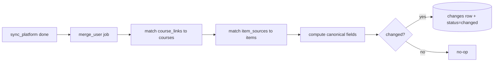

# S16 — Merge and change detection

| | |
|---|---|
| **Status** | In progress (Neal): built + tested on `neal/s16-merge`; awaiting review |
| **Stage** | 3 (course matching minimal version in Stage 1) |
| **Role** | A |
| **Depends on** | S11, S14 |
| **Folders** | `backend/app/sync/merge.py` |

## Purpose
Turn per-platform records into one clean view: **one course** per real class across Canvas/Gradescope/Echo360, and **one item** per real deadline even if it appears on several platforms. Keep canonical items' change history accurate ("Midterm moved").

## Inputs
- `merge_user(user_id)` job, enqueued after every sync (S10).
- `course_links`, `item_sources`, existing `courses`, `items`.

## Outputs
- `course_links.course_id` set; new `courses` rows when no match.
- `item_sources.item_id` set; canonical `items` created/updated.
- `changes` rows for canonical item field changes (`entity_type="item"`).

## Interface
```python
def normalize_course_code(raw: str) -> CourseCode            # "COMPSCI 311 SEC 01" -> ("COMPSCI", "311")
def match_course(link: CourseLinkRow, courses: list[CourseRow]) -> CourseRow | None
def match_item(src: ItemSourceRow, candidates: list[ItemRow]) -> ItemRow | None
def canonical_fields(sources: list[ItemSourceRow]) -> CanonicalItem   # precedence rules below
async def merge_user(user_id: UUID) -> MergeStats
```

## Rules
**Course matching** (in order):
1. Same normalized `(dept, number)` and same term → match. Dept aliases: `CS`/`CMPSCI`/`COMPSCI` → `COMPSCI`; `MATH`; `STAT`/`STATS` → `STATS` (extend the table as found).
2. Echo360 sections match via the Canvas course they were launched from (S15), when known.
3. No match → create a new course from the link (Canvas preferred as the canonical name source).

**Item matching** (within the same canonical course):
1. Exact same platform record → same item (trivial).
2. Different platform: match if `type` compatible (both exams, or both assignment-like) **and** title similarity ≥ 0.75 (`rapidfuzz.token_set_ratio`/100, after removing words like "submit", "gradescope") **and** due dates within 36 hours (or one is null).
3. Ordinal guard: "Midterm 1" never matches "Midterm 2"; "HW 4" never matches "HW 5" (numbers in titles must be equal if both have one).
4. Ambiguous (two candidates pass) → don't merge; keep separate (better duplicate than wrong merge).

**Canonical field precedence:** `title`, `due_at`, `points`: Canvas > Gradescope > others; but if the Canvas source has `due_at=null` and Gradescope has one, use Gradescope's. `type`: exam wins over others.

**Change detection on canonical items:** when canonical `due_at`/`title`/`points` change, write a `changes` row with old/new and set `items.status=changed` (cleared to `active` when the student marks changes seen). Items whose sources are all `removed` → `removed`.

## Data flow


## Errors and edge cases
| Case | Expected behavior |
|---|---|
| Student in two sections of the same course code (rare) | Different terms or Canvas IDs → separate courses |
| Gradescope title "Homework 4 (PDF)" vs Canvas "HW4" | Normalization + ordinal rule → match |
| Exam only on a calendar event, not an assignment | Still an item (S11), merges normally |

## Acceptance criteria
- [x] Seed data (S03) items with Canvas + Gradescope sources show as one item (merge on a seeded user is a no-op)
- [x] No false merges on the curated test cases
- [x] Moving a due date on one source produces exactly one canonical change

## Test plan
| ID | Test | Type |
|---|---|---|
| S16-T01 | Course code normalization + aliases (table-driven) | unit |
| S16-T02 | Canvas + Gradescope course with same code/term → one course | unit |
| S16-T03 | Item match: similar title + close dates → merged | unit |
| S16-T04 | Ordinal guard: Midterm 1 vs Midterm 2 never merge | unit |
| S16-T05 | Ambiguous candidates → not merged | unit |
| S16-T06 | Precedence: Canvas title/due wins; Gradescope fills null due | unit |
| S16-T07 | Canonical due change writes one `changes` row, status `changed` | integration |
| S16-T08 | All sources removed → item removed | integration |
| S16-T09 | `merge_user` is idempotent (running twice changes nothing) | integration |

## Out of scope
LLM-based deadline extraction from syllabi/emails/announcements (stretch: would create `item_sources` with `platform` of the post); manual merge/split UI.

## Implementation notes (2026-11-14, Neal)
- Code: `backend/app/sync/merge.py` (`merge_user(conn, user_id, *, clock=None) -> MergeStats`, plus the pure `match_course`, `match_item`, `items_match`, `canonical_fields`, `clean_title`, `normalize_term`). The `merge_user` task in `sync/jobs.py` calls it after each successful sync. Course codes use the shared `app/core/courses.normalize_course_code` (unchanged). Tests: `tests/unit/test_s16_merge_unit.py`, `tests/integration/test_s16_merge_db.py`.
- **Change rows: one place, S16.** The S10 pipeline no longer writes `changes` rows for `item_sources` (neither field changes nor `status=removed`); it only stores the source (`status='changed'`). `merge_user` compares each item's recomputed canonical fields with the stored item and writes one row per changed `title`/`due_at`/`points` (`entity_type='item'`, `entity_id` = canonical item) and sets `items.status='changed'`; when all sources are removed it writes one `status` → `removed` row. So a Gradescope due date moving under a Canvas due date writes nothing. Posts/materials changes are still written by the pipeline. S10-T03 was updated to run `merge_user` before asserting the row. Side effect: a source change becomes visible as a change only after the merge job (seconds later).
- **Course matching:** `match_course(course, kept)` works on canonical courses (not single links): every link already has a course because the pipeline creates one per platform course. Courses are visited Canvas-first; a course merges into the single kept course with the same normalized code **and** term (`normalize_term`: "Fall 2026" = "2026 fall" = "FA26"; `null` only equals `null`) and no platform in common. Two same-platform courses (sections) never merge; a third course matching both is ambiguous and stays separate. Merging re-points `course_id` in course_links, items, item_sources, materials, posts, chunks, changes, study_sets, study_blocks, misses, fills null code/term/color on the kept course, and deletes the other. Rule 2 (Echo360 via launching Canvas course) is not implemented (no S15 data yet); Echo360 courses with a code match by rule 1.
- **Item matching** (same course): units are unattached sources plus items whose course was merged in this run (so items created on both sides before the courses matched still fold together: sources, study_blocks.item_id and changes.entity_id move to the kept item, the other item is deleted). Units go Canvas-first. Titles are cleaned (`HW4` → `homework 4`, `PS3` → `problem set 3`, noise words submit/submission/gradescope/canvas/pdf/upload/online/on/via/here dropped) before `token_set_ratio`. Type families: `exam`, assignment-like, or unknown (`other`/missing: compatible with both); an `assignment`/`other` titled with midterm/exam/prelim (and no homework/review/practice/lab/project/quiz word) counts as an exam, since Gradescope lists exams as assignments. Ambiguity also covers two same-platform records wanting one item (neither merges). Removed sources never match; an unmatched source gets its own item.
- **Precedence:** first non-null by Canvas > Gradescope > others for title/due_at/points/description; type: exam wins, else the first known non-`other`. Seeded sources without `raw._normalized` fall back to `raw.points` and keep the item's type/description.
- **No change rows when an item was created or gained sources in this run** (a newly connected platform renaming the item is a merge, not news). A source being **removed** does produce changes if the canonical values move to the remaining source (e.g. Canvas assignment deleted, Gradescope copy remains).
- Runs in one transaction behind `pg_advisory_xact_lock('merge:<user>')`; a second run writes nothing (`MergeStats` all zero, S16-T09).
- Known gap (pipeline, not merge): after two courses merge, a later *changed* Gradescope course record updates the canonical course's `name` (pipeline `course()` writes `courses.name` for any platform), overwriting the Canvas name. Fix in the pipeline: only rename the course from Canvas, or when it has no Canvas link.
