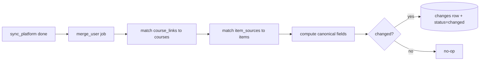

# S16 — Merge and change detection

| | |
|---|---|
| **Status** | Draft |
| **Stage** | 3 (course matching minimal version in Stage 1) |
| **Role** | A |
| **Depends on** | S11, S14 |
| **Folders** | `backend/app/sync/merge.py` |

## Purpose
Turn per-platform records into one clean view: **one course** per real class across Canvas/Gradescope/Echo360, and **one item** per real deadline even if it appears on several platforms. Keep canonical items' change history accurate ("Midterm moved").

## Inputs
- `merge_user(user_id)` job, enqueued after every sync (S10).
- `course_links`, `item_sources`, existing `courses`, `items`.

## Outputs
- `course_links.course_id` set; new `courses` rows when no match.
- `item_sources.item_id` set; canonical `items` created/updated.
- `changes` rows for canonical item field changes (`entity_type="item"`).

## Interface
```python
def normalize_course_code(raw: str) -> CourseCode            # "COMPSCI 311 SEC 01" -> ("COMPSCI", "311")
def match_course(link: CourseLinkRow, courses: list[CourseRow]) -> CourseRow | None
def match_item(src: ItemSourceRow, candidates: list[ItemRow]) -> ItemRow | None
def canonical_fields(sources: list[ItemSourceRow]) -> CanonicalItem   # precedence rules below
async def merge_user(user_id: UUID) -> MergeStats
```

## Rules
**Course matching** (in order):
1. Same normalized `(dept, number)` and same term → match. Dept aliases: `CS`/`CMPSCI`/`COMPSCI` → `COMPSCI`; `MATH`; `STAT`/`STATS` → `STATS` (extend the table as found).
2. Echo360 sections match via the Canvas course they were launched from (S15), when known.
3. No match → create a new course from the link (Canvas preferred as the canonical name source).

**Item matching** (within the same canonical course):
1. Exact same platform record → same item (trivial).
2. Different platform: match if `type` compatible (both exams, or both assignment-like) **and** title similarity ≥ 0.75 (`rapidfuzz.token_set_ratio`/100, after removing words like "submit", "gradescope") **and** due dates within 36 hours (or one is null).
3. Ordinal guard: "Midterm 1" never matches "Midterm 2"; "HW 4" never matches "HW 5" (numbers in titles must be equal if both have one).
4. Ambiguous (two candidates pass) → don't merge; keep separate (better duplicate than wrong merge).

**Canonical field precedence:** `title`, `due_at`, `points`: Canvas > Gradescope > others; but if the Canvas source has `due_at=null` and Gradescope has one, use Gradescope's. `type`: exam wins over others.

**Change detection on canonical items:** when canonical `due_at`/`title`/`points` change, write a `changes` row with old/new and set `items.status=changed` (cleared to `active` when the student marks changes seen). Items whose sources are all `removed` → `removed`.

## Data flow


## Errors and edge cases
| Case | Expected behavior |
|---|---|
| Student in two sections of the same course code (rare) | Different terms or Canvas IDs → separate courses |
| Gradescope title "Homework 4 (PDF)" vs Canvas "HW4" | Normalization + ordinal rule → match |
| Exam only on a calendar event, not an assignment | Still an item (S11), merges normally |

## Acceptance criteria
- [ ] Seed data (S03) items with Canvas + Gradescope sources show as one item
- [ ] No false merges on the curated test cases
- [ ] Moving a due date on one source produces exactly one canonical change

## Test plan
| ID | Test | Type |
|---|---|---|
| S16-T01 | Course code normalization + aliases (table-driven) | unit |
| S16-T02 | Canvas + Gradescope course with same code/term → one course | unit |
| S16-T03 | Item match: similar title + close dates → merged | unit |
| S16-T04 | Ordinal guard: Midterm 1 vs Midterm 2 never merge | unit |
| S16-T05 | Ambiguous candidates → not merged | unit |
| S16-T06 | Precedence: Canvas title/due wins; Gradescope fills null due | unit |
| S16-T07 | Canonical due change writes one `changes` row, status `changed` | integration |
| S16-T08 | All sources removed → item removed | integration |
| S16-T09 | `merge_user` is idempotent (running twice changes nothing) | integration |

## Out of scope
LLM-based deadline extraction from syllabi/emails/announcements (stretch: would create `item_sources` with `platform` of the post); manual merge/split UI.
