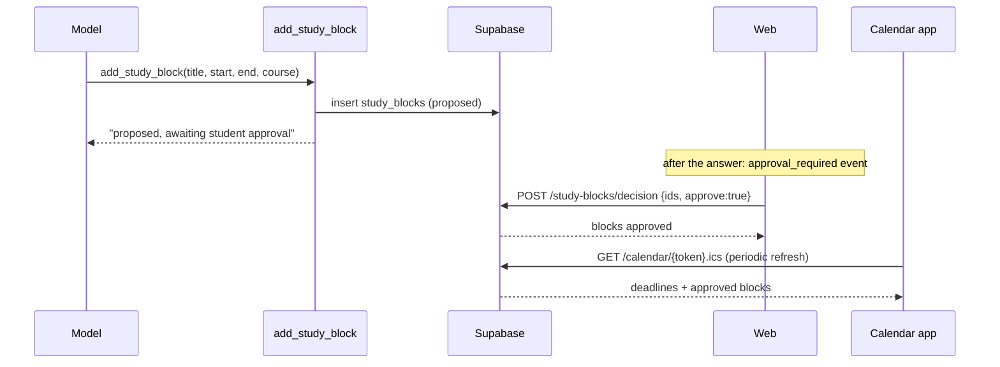

# S25 — Study blocks, approvals and calendar feed

| | |
|---|---|
| **Status** | Implemented on review branch; external calendar import check pending (Neal, 2026-11-14) |
| **Stage** | 2 |
| **Role** | B |
| **Depends on** | S22 |
| **Folders** | `backend/app/agent/tools/study_blocks.py`, `backend/app/calendar/`, `backend/app/api/routes/calendar.py` |

## Purpose
Let the agent suggest study sessions that the student **approves with a click** before anything is written to their calendar, and publish deadlines + approved sessions as a private `.ics` feed any calendar app can subscribe to.

## Design plan: proposal pattern (no paused runs)
The tool **never writes to the calendar**. It creates `study_blocks` with `status="proposed"` and returns "proposed, awaiting approval." After the answer, the UI shows Add / Skip. The decision endpoint flips status. This avoids pausing and resuming agent runs and works the same with every model provider.



## Inputs
```python
class AddStudyBlockArgs(BaseModel):
    title: str                    # <= 80 chars
    start_local: datetime         # naive, interpreted in the student's timezone
    duration_min: int             # 15..240
    course: str | None
    item_id: str | None           # exam/assignment this prepares for
```
- `POST /study-blocks/decision {block_ids, approve}`.
- `GET /calendar/{token}.ics` from calendar apps (no auth; token is the secret).

## Outputs
- `study_blocks` rows (`proposed` → `approved` | `declined`).
- SSE `approval_required {blocks, summary}` once per run (S22).
- ICS feed (`text/calendar; charset=utf-8`).

## Behavior and rules
1. **Validation:** start in the future; within 30 days; no overlap with another `approved`/`proposed` block of the same user; max 10 proposals per run. Violations return a readable error to the model.
2. Local time converted to UTC using the profile timezone (DST-safe).
3. Decision endpoint only changes `proposed` blocks belonging to the user; already-decided blocks are returned unchanged. Proposed blocks older than 24 h with no decision are treated as declined.
4. **Feed contents:** active items with `due_at` from 7 days ago to 120 days ahead (VEVENT: `SUMMARY="[COMPSCI 311] Midterm 1"`, `DTSTART=due_at-15min`, `DTEND=due_at`, `URL`=first source URL, `DESCRIPTION` with sources), plus `approved` study blocks. `UID` stable: `item-<id>@<app-domain>` / `block-<id>@<app-domain>`; `SEQUENCE` increments when an item's due date changes; `LAST-MODIFIED` set.
5. Feed token: 32 random bytes URL-safe; created on first `GET /calendar/feed`; `rotate` invalidates the old URL immediately.
6. Feed responses: `Cache-Control: max-age=900`; unknown token → 404 (no information leak).
7. Built with the `icalendar` library; output validated by a parser in tests.
8. Known limitation (show in UI copy): calendar apps refresh subscribed feeds on their own schedule (Google can take hours).

## Errors and edge cases
| Case | Expected behavior |
|---|---|
| Model proposes a block in the past | Tool error: "start must be in the future (now is …)" |
| DST transition day | Correct UTC conversion (test) |
| Item due date changes | Same UID, higher SEQUENCE |
| Student declines | Blocks `declined`; never appear in feed |

## Acceptance criteria
- [x] Proposed blocks only appear in the feed after approval
- [ ] Feed imports cleanly into Google Calendar and Apple Calendar (manual check)
- [x] Rotating the token breaks the old URL

## Test plan
| ID | Test | Type |
|---|---|---|
| S25-T01 | Valid proposal inserts `proposed` block and returns awaiting message | integration |
| S25-T02 | Past start / >30 days / overlap / >10 per run rejected with readable errors | unit |
| S25-T03 | Local → UTC conversion across a DST boundary | unit |
| S25-T04 | Decision approves/declines only the caller's proposed blocks | integration |
| S25-T05 | Feed includes active items + approved blocks, excludes proposed/declined/removed | integration |
| S25-T06 | Stable UIDs; SEQUENCE increments on due change | unit |
| S25-T07 | Feed parses with `icalendar` and has required fields | unit |
| S25-T08 | Unknown/rotated token → 404 | integration |
| S25-T09 | `approval_required` emitted once with all proposals of the run | runtime |

## Out of scope
Writing directly to Google/Outlook calendars (OAuth), editing blocks after approval (delete + re-propose instead), reminders/notifications.

## Implementation clarifications (2026-11-14)
- Google Calendar integration is the private subscription-feed design above; direct OAuth writes remain out of scope. Google must be able to fetch a public HTTPS API URL. On localhost, validate/download ICS; a Google subscription cannot reach the laptop's loopback address. Never advertise successful Google subscription from a local link.
- Nonexistent or ambiguous local clock times at DST transitions are rejected with a readable request for another time, rather than silently choosing an offset.
- Feed-token lookup is a private repository helper: the secret is the authorization for this one public endpoint. Every subsequent content query uses its resolved user ID. Feed tokens must not be written to request logs.

## Implementation plan
1. Add scoped repository operations for private feed links, deadline selection, approval decisions and atomic overlap checks; retain the existing schema and response contracts.
2. Register `add_study_block` with the existing runtime; validate local time and save proposals before emitting one approval card.
3. Render escaped ICS with `icalendar`; resolve the private URL to its owner before scoped reads and redact URL secrets from access logs.
4. Reuse calendar controls in onboarding and Settings. Local feeds offer downloads; public HTTPS feeds offer subscription links.
5. Verify fixtures, real local Postgres, scripted streaming, frontend regression tests, production build and browser flows; document external calendar checks separately.

## Verification checkpoint (2026-11-14)
- Initial new S25 tests failed against the old stubs before implementation. Database tests now cover owner isolation, proposal persistence/overlap, decisions/expiry, feed contents, stable IDs/sequences, escaping and link rotation.
- Unit tests cover valid/past/future proposals, maximum count, overlap, DST ambiguity/nonexistence and private access-log redaction. Scripted runtime exercises the actual proposal tool and a single approval event.
- Full backend suite: 452 passed, 1 skipped, 1 expected failure before the additional actual-tool runtime case; that runtime suite rerun is recorded in the devlog. Frontend: 72 passed; browser: 6 passed; lint/types/build passed.
- Pending: manual import into Google and Apple; automatic subscriptions require public HTTPS hosting. No direct Google OAuth integration is claimed. See [calendar runbook](../calendar-runbook.md).
