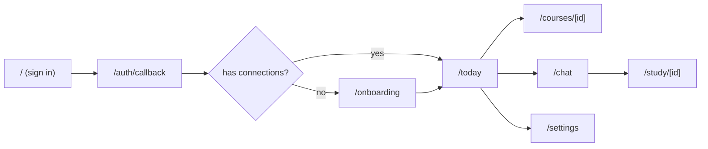

# S30 — Frontend shell and auth

| | |
|---|---|
| **Status** | Draft |
| **Stage** | 1 |
| **Role** | C |
| **Depends on** | S00, S02 |
| **Folders** | `apps/web/src/app/`, `apps/web/src/lib/`, `apps/web/src/components/layout/` |

## Purpose
The app frame every screen lives in: routes, layout and navigation, Supabase sign-in, the typed API client, the SSE client, and shared UI states (loading, empty, error, stale).

## Inputs
- Supabase Auth (Google + email magic link).
- Generated API types (`make types`, S02); MSW mocks for development without the backend.

## Outputs
- Authenticated app with these routes:

| Route | Screen | Spec |
|---|---|---|
| `/` | Landing + sign in (redirects to `/today` if signed in) | S30 |
| `/auth/callback` | Supabase auth callback | S30 |
| `/onboarding` | Connect flow (redirect here if no connections) | S31 |
| `/today` | Today view | S32 |
| `/courses/[id]` | Course page | S32 |
| `/chat`, `/chat/[conversationId]` | Chat | S33 |
| `/study/[studySetId]` | Study set (plan / quiz / flashcards) | S33 |
| `/settings` | Settings | S34 |



## Interface
```ts
// src/lib/api/client.ts
export function api(): ApiClient                 // typed from generated schema; attaches Supabase access token
export class ApiError extends Error { code: string; retryable: boolean }

// src/lib/api/sse.ts
export async function streamChat(body: ChatRequest, handlers: {
  onEvent: (e: ChatEvent) => void; signal?: AbortSignal }): Promise<void>
// ChatEvent = discriminated union of the S02 SSE events

// src/components/states/
<Loading/> <Empty title action?/> <ErrorState error onRetry/> <StaleBanner sources/>
```

## Behavior and rules
1. Layout: left sidebar on desktop (Today, Courses, Chat, Study, Settings), bottom tab bar on mobile (< 768 px). Course colors used consistently.
2. **Auth:** Supabase JS client with session persistence; protected routes redirect to `/` when signed out; token refreshed automatically; 401 from API → sign out + redirect.
3. **Data fetching:** TanStack Query for GETs (cache, retries for `retryable` errors only); mutations invalidate relevant queries.
4. **SSE client:** `fetch` POST with `Authorization`, read `response.body` stream, parse `event:`/`data:` frames (handles frames split across chunks), dispatch typed events; abort on unmount or "Stop" button.
5. **Dev without backend:** `NEXT_PUBLIC_API_MOCKS=1` enables MSW with S02 handlers (incl. scripted chat stream). **The MSW handlers are built here** (moved from S02, which also moves S02-T05/T06 here). Build them from `src/lib/api/openapi.json`, `schema.d.ts` and `backend/app/api/CONTRACT.md`. Alternative: run the backend stubs with `make api`; they already return realistic mock data and a scripted chat stream (`POST /chat?delay_ms=150`).
6. Accessibility: keyboard navigation, focus states, `aria-live="polite"` for streaming text and status lines, color contrast AA.
7. Times displayed in the profile timezone (from `/me`), relative where useful ("in 3 days").
8. Design: shadcn/ui components, Tailwind tokens, light + dark mode.

## Errors and edge cases
| Case | Expected behavior |
|---|---|
| API down | Error state with retry; Today shows last cached data if available |
| Token expired mid-session | Silent refresh; if refresh fails, redirect to sign in |
| SSE connection drops | Show partial answer + "Connection lost, retry" |

## Acceptance criteria
- [ ] Sign in with Google and magic link works against Supabase
- [ ] All routes render (with mocks) and are protected
- [ ] SSE client reconstructs a scripted stream exactly
- [ ] Mobile layout usable at 375 px width

## Test plan
| ID | Test | Type |
|---|---|---|
| S30-T01 | Protected route redirects to `/` when signed out | component |
| S30-T02 | API client attaches bearer token and maps error envelope to `ApiError` | component |
| S30-T03 | 401 triggers sign-out redirect | component |
| S30-T04 | SSE parser: multiple events in one chunk, one event split across chunks | unit |
| S30-T05 | SSE parser ignores unknown event types without crashing | unit |
| S30-T06 | Layout switches sidebar ↔ bottom tabs at breakpoint | component |
| S30-T07 | E2E (mocked): sign in → lands on `/today` | e2e |
| S30-T08 | Mock mode: app waits for the mock API; if it can’t start, a plain message + Try again (no endless spinner) | component |

## Out of scope
Push notifications, offline mode, i18n.
