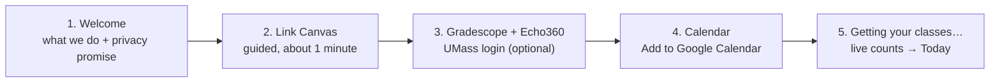

# S31 — Onboarding and connect flow

| | |
|---|---|
| **Status** | Draft |
| **Stage** | 2 |
| **Role** | C |
| **Depends on** | S30, S11 (Canvas endpoint), S13 (login endpoints) |
| **Folders** | `apps/web/src/app/onboarding/`, `apps/web/src/components/connect/` |

## Purpose
Get a new student from sign-in to a populated dashboard in a few minutes: connect Canvas with a token, connect Gradescope and Echo360 through the live login, pick a model, and subscribe to the calendar feed. Also reused from Settings for reconnecting.

## Steps

**Audience:** non-technical students ([01-vision](../01-vision.md#built-for-non-technical-students-top-product-rule)). No model choice during onboarding (a good default is set; choice lives in Settings → Advanced, S34). No expiry dates, URLs or jargon to handle.

## Inputs / outputs per step
| Step | User input | API calls | Success state |
|---|---|---|---|
| 1 Welcome | Continue | — | — |
| 2 Link Canvas | Paste the code they copied from Canvas | `POST /connections/canvas {token}` (no expiry; API defaults +90 days) | "Canvas linked: 4 classes found" |
| 3 UMass login | Click "Connect Gradescope" / "Connect Echo360" | `POST /connections/{p}/login`, poll `GET .../login/{id}` every 2 s | "Connected"; else "Skip for now" |
| 4 Calendar | Click **Add to Google Calendar** (or "Apple / Outlook" link) | `GET /calendar/feed` | "Added" (or "Skip") |
| 5 Getting your classes | — | poll `GET /sync/status` every 3 s | Counts appear; "Go to Today" enabled after Canvas first sync succeeds |

## Behavior and rules
1. **Canvas link guide (the only "technical" step, so it must be foolproof):** headline "Link your Canvas (about 1 minute)". Three numbered steps with **real screenshots** of UMass Canvas: (a) button **"Open my Canvas settings"** opens `https://umass.instructure.com/profile/settings` in a new tab; (b) "Scroll to *Approved Integrations*, click **+ New Access Token**, type *Study Agent* as the purpose, pick the **latest** expiry date, click **Generate Token**"; (c) "Copy the long code and paste it here." Privacy line: "We can only read your Canvas. We never submit or change anything." Optional 20-second GIF of the steps.
2. Paste box: one big field labelled "Paste your Canvas code", masked after paste, trims whitespace, validates on paste (no submit button needed). Friendly errors: `invalid_token` → "That code didn't work. Make sure you copied the whole thing (it's long!)."
3. **Live login UI:** in `local` mode show "A browser window opened on this computer. Log in with your NetID and approve Duo." In `hosted` mode embed `live_view_url` in an iframe (stretch). Show a spinner + "Waiting for login…", a Cancel button, and handle `expired`/`failed` with retry.
4. Every connector step is skippable except Canvas.
5. Progress saved: refreshing the page resumes at the first incomplete step (derived from `/me` connections).
6. Reconnect mode: `?reconnect=gradescope` jumps to that platform's step and returns to Settings when done.
7. Copy is plain language; no technical jargon ("session cookie" → "stay logged in", "sync" → "keep your classes up to date", "token" only where Canvas itself uses the word).
8. Calendar: **Add to Google Calendar** uses Google's "add by URL" link with our feed URL; also "Apple Calendar" (`webcal://`) and "Outlook" links. Note under it: "New study sessions can take a few hours to show up in Google Calendar."

## Errors and edge cases
| Case | Expected behavior |
|---|---|
| Canvas unreachable | "Canvas isn't responding, try again in a minute" (retryable) |
| Login already in progress (409) | Resume polling the existing login |
| Student closes the tab mid-login | Next visit shows the step again; old login expires server-side |

## Acceptance criteria
- [ ] New account → Today with real Canvas data in under 3 minutes (manual, timed)
- [ ] All error codes have friendly messages
- [ ] Usable on mobile (except local-mode live login, which needs the laptop)

## Test plan
| ID | Test | Type |
|---|---|---|
| S31-T01 | Canvas step: success shows connected name; `invalid_token` shows friendly error | component |
| S31-T02 | Live login polling: pending → succeeded updates UI; expired shows retry | component |
| S31-T03 | Skipping optional steps reaches the syncing step | component |
| S31-T04 | Refresh resumes at first incomplete step | component |
| S31-T05 | Reconnect mode returns to settings after success | component |
| S31-T06 | E2E (mocked): full onboarding → Today | e2e |
| S31-T07 | No onboarding screen contains the words token (outside the Canvas instructions), sync, MCP, model or API | component |
| S31-T08 | Calendar step renders Google/Apple/Outlook links built from the feed URL | component |

## Out of scope
Piazza/email connect (stretch), hosted live view iframe (stretch), **one "Connect my UMass account" login for all platforms without a Canvas token (stretch, see S13)**.
