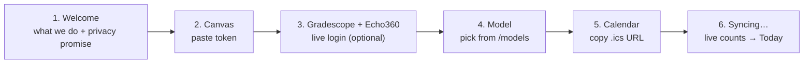

# S31 — Onboarding and connect flow

| | |
|---|---|
| **Status** | Draft |
| **Stage** | 2 |
| **Role** | C |
| **Depends on** | S30, S11 (Canvas endpoint), S13 (login endpoints) |
| **Folders** | `apps/web/src/app/onboarding/`, `apps/web/src/components/connect/` |

## Purpose
Get a new student from sign-in to a populated dashboard in a few minutes: connect Canvas with a token, connect Gradescope and Echo360 through the live login, pick a model, and subscribe to the calendar feed. Also reused from Settings for reconnecting.

## Steps

## Inputs / outputs per step
| Step | User input | API calls | Success state |
|---|---|---|---|
| 1 Welcome | Continue | — | — |
| 2 Canvas | Token (+ expiry date, default today+90d) | `POST /connections/canvas` | "Connected as <name>" |
| 3 Live login | Click "Connect Gradescope" / "Connect Echo360" | `POST /connections/{p}/login`, poll `GET .../login/{id}` every 2 s | "Connected"; else "Skip for now" |
| 4 Model | Choose option | `GET /models`, `PATCH /me` | Saved |
| 5 Calendar | Copy URL / "Add to Google Calendar" link | `GET /calendar/feed` | Copied |
| 6 Syncing | — | poll `GET /sync/status` every 3 s | Counts appear; "Go to Today" enabled after Canvas first sync succeeds |

## Behavior and rules
1. **Canvas token guide:** inline numbered steps with screenshots (Account → Settings → + New Access Token → purpose "<app name>", expiry → copy), a button opening `https://umass.instructure.com/profile/settings` in a new tab, and the privacy line: "We only read your Canvas data. We never submit anything."
2. Token field: masked, paste-friendly, trims whitespace; error messages mapped from S02 codes (`invalid_token` → "Canvas didn't accept that token. Check you copied all of it.").
3. **Live login UI:** in `local` mode show "A browser window opened on this computer. Log in with your NetID and approve Duo." In `hosted` mode embed `live_view_url` in an iframe (stretch). Show a spinner + "Waiting for login…", a Cancel button, and handle `expired`/`failed` with retry.
4. Every connector step is skippable except Canvas.
5. Progress saved: refreshing the page resumes at the first incomplete step (derived from `/me` connections).
6. Reconnect mode: `?reconnect=gradescope` jumps to that platform's step and returns to Settings when done.
7. Copy is plain language; no technical jargon ("session cookie" → "stay logged in").

## Errors and edge cases
| Case | Expected behavior |
|---|---|
| Canvas unreachable | "Canvas isn't responding, try again in a minute" (retryable) |
| Login already in progress (409) | Resume polling the existing login |
| Student closes the tab mid-login | Next visit shows the step again; old login expires server-side |

## Acceptance criteria
- [ ] New account → Today with real Canvas data in under 3 minutes (manual, timed)
- [ ] All error codes have friendly messages
- [ ] Usable on mobile (except local-mode live login, which needs the laptop)

## Test plan
| ID | Test | Type |
|---|---|---|
| S31-T01 | Canvas step: success shows connected name; `invalid_token` shows friendly error | component |
| S31-T02 | Live login polling: pending → succeeded updates UI; expired shows retry | component |
| S31-T03 | Skipping optional steps reaches the syncing step | component |
| S31-T04 | Refresh resumes at first incomplete step | component |
| S31-T05 | Reconnect mode returns to settings after success | component |
| S31-T06 | E2E (mocked): full onboarding → Today | e2e |

## Out of scope
Piazza/email connect (stretch), hosted live view iframe (stretch).
